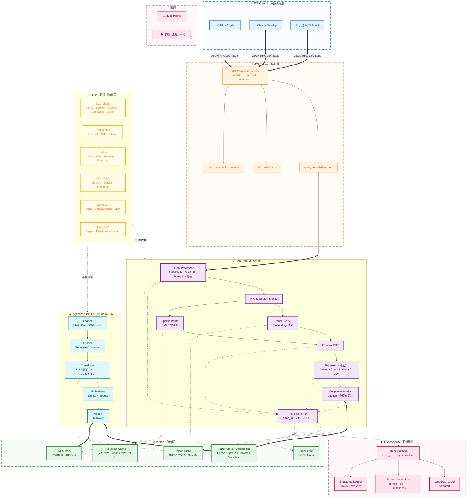
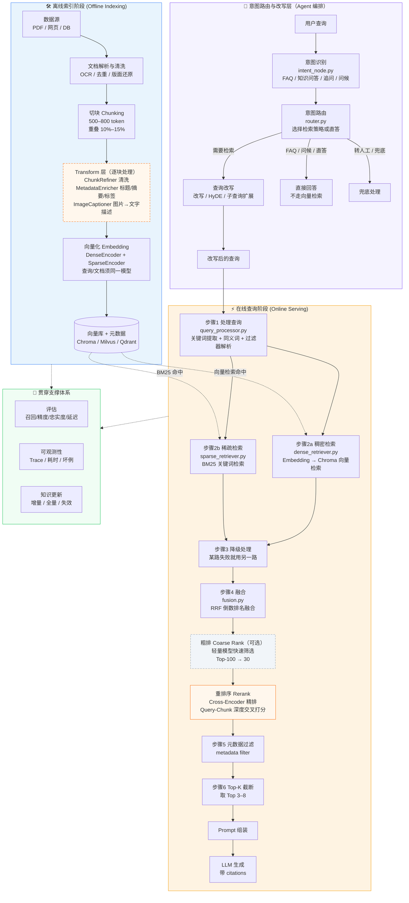
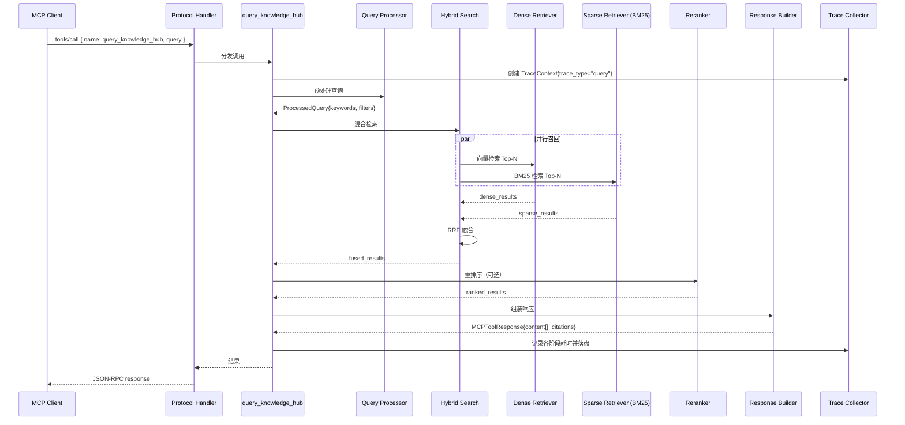
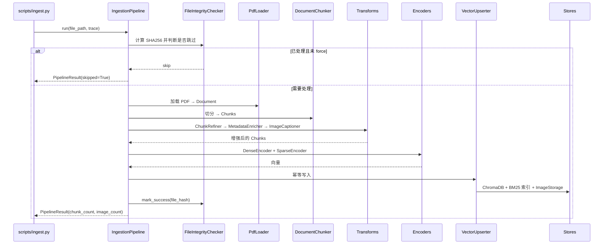
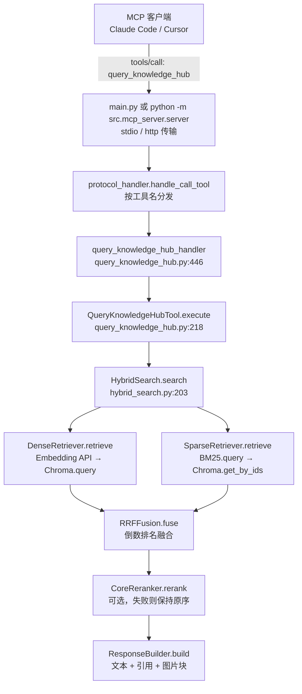

# 项目架构与 Setup Skill 分析

> 本文档为 README 的分析补充材料：
> - 第一部分（第 1–5 节）取自 `DEV_SPEC.md` 第 5.1 节「整体架构图」，整理为 ASCII 与 Mermaid 两种形式；
> - 第二部分（第 6 节）剖析 README「一键配置（Setup Skill）」背后的实现机制；
> - 第三部分（第 7 节）是**在本机实际跑一遍**的结果记录，包含可直接复制的命令与踩到的坑。

## 目录

- [一、原始 ASCII 架构图](#一原始-ascii-架构图)
- [二、Mermaid 架构图](#二mermaid-架构图)
- [三、分层职责速览](#三分层职责速览)
- [四、检索链路时序](#四检索链路时序)
- [五、离线摄取链路时序](#五离线摄取链路时序)
- [六、Setup Skill 是怎么实现的](#六setup-skill-是怎么实现的)
  - [6.1 结论先行：没有代码](#61-结论先行没有代码)
  - [6.2 第 0 层：物理约定](#62-第-0-层物理约定)
  - [6.3 第 1 层：发现（Discovery）](#63-第-1-层发现discovery)
  - [6.4 第 2 层：触发（Trigger）](#64-第-2-层触发trigger)
  - [6.5 第 3 层：加载（Progressive Disclosure）](#65-第-3-层加载progressive-disclosure)
  - [6.6 第 4 层：执行（LLM as Interpreter）](#66-第-4-层执行llm-as-interpreter)
  - [6.7 端到端链路](#67-端到端链路)
  - [6.8 为什么这种设计能成立](#68-为什么这种设计能成立)
  - [6.9 已知局限与实情](#69-已知局限与实情)
  - [6.10 自己实现一个 Skill 的最小步骤](#610-自己实现一个-skill-的最小步骤)
- [七、怎么把项目跑起来（实测记录）](#七怎么把项目跑起来实测记录)
  - [7.1 结论先行：main.py 不是启动入口](#71-结论先行mainpy-不是启动入口)
  - [7.2 环境现状](#72-环境现状)
  - [7.3 先补 API Key](#73-先补-api-key)
  - [7.4 四条可跑的命令](#74-四条可跑的命令)
  - [7.5 已修复的问题清单](#75-已修复的问题清单)
  - [7.6 测试现状](#76-测试现状)

---

## 一、Mermaid 架构图



---

## 三、分层职责速览

| 层 | 职责 | 关键模块 |
|---|---|---|
| **MCP Clients** | 外部宿主，通过 JSON-RPC 2.0 over stdio 调用 | GitHub Copilot / Claude Desktop |
| **MCP Server** | 协议解析、工具注册与分发 | `src/mcp_server/protocol_handler.py`、`src/mcp_server/tools/*` |
| **Core** | 检索全链路：预处理 → 混合召回 → RRF 融合 → 重排 → 响应组装 | `src/core/query_engine/*`、`src/core/response/*`、`src/core/trace/*` |
| **Storage** | 向量 / 稀疏索引 / 图片 / 日志 / 缓存五类持久化 | ChromaDB、BM25 索引、SQLite、JSONL |
| **Ingestion** | 离线五段式流水线 | `src/ingestion/pipeline.py` |
| **Libs** | 六类可插拔组件的抽象接口 + 工厂 | `src/libs/*/base_*.py`、`src/libs/*/*_factory.py` |
| **Observability** | Trace 采集 + Dashboard + 评估 | `src/observability/*` |

### 设计要点

1. **分层清晰**：Client → 接口层 → 核心层 → 存储层，每层只依赖下层接口，不依赖具体实现。
2. **全链路可插拔**：Libs 层为 6 类组件定义 `Base*` 抽象接口，通过工厂 + `settings.yaml` 实现零代码切换 Provider。
3. **两段式检索**：Hybrid Search 做低成本泛召回（Dense + Sparse 双路），Reranker 做高成本精排。
4. **可观测贯穿全链路**：Core 层每个阶段通过 `TraceContext.record_stage()` 打点，最终由 `TraceCollector` 落盘为 JSON Lines，供 Dashboard 与评估模块消费。
5. **多模态闭环**：Ingestion 阶段用 Vision LLM 生成图片描述并写入 `metadata.image_captions`，检索阶段命中后由 `ResponseBuilder` 组装为 `ImageContent`（Base64）返回。





## 四、在线检索-链路时序


```
                   ┌──> Dense (Chroma 向量检索 20 条)：抓语义
用户输入 "BOM25怎么接线" │
                   └──> Sparse (BM25 内存检索 20 条)：抓关键词 
                            ↓
                     RRF 融合算法（倒数排名融合）
                            ↓
              找出既语义相关、又包含关键字的 Top 10
```




---

## 五、离线数据摄入-链路时序



代码: src/ingestion/pipeline.py

```python
# 开启离线数据摄入(Ingestion Pipeline)
# Document （文档加载）
# chunking （切分
# Transform (增强)
# Embedding （向量化）
# storage （存储）)
pipeline = IngestionPipeline(settings, collection=collection)
pipeline.run(
    file_path=tmp_path,
    trace=trace,
    on_progress=on_progress,
)
progress_bar.progress(1.0, text=tr("ingestion_manager.complete"))
status_text.success(
    tr("ingestion_manager.success", file=uploaded_file.name, collection=collection)
)
```

### 存储

前置节点生成

```json
{
      "id": "101872d7_0000_93c6e5d0",
      "embedding": [0.013, -0.221, ...],        # 1536 维 → HNSW *.bin
      "document": "...正文...",                  # metadata["text"] 或 id
      "metadata": {
          "source_path": "D:\\docs\\报告.pdf",   # Loader 写入
          "doc_type": "pdf",
          "chunk_index": 0,
          "title": "报告标题",
          "tags": "api,sdk",                     # list → 逗号字符串
          "images": "{'id': '101872d7_1_1', ...}",  # dict/list → str()
          "summary": "...",
          "text": "...正文...",                  # VectorUpserter 补的
          "chunk_id": "101872d7_0000_93c6e5d0"  # VectorUpserter 补的
      }
  }
```

```
三库关系
Chroma  id  ──────────── chunk_id ────────────  BM25 postings
   │
   └─ metadata.images[].id ── image_id ── image_index.db ── 磁盘文件
```

#### ChromaStore存储格式

注意: 在ChromaStore.upsert函数中会把metadata处理成单独的字段最终入库的数据是：

```json
位置：data/db/chroma/（chroma.sqlite3 + HNSW 段 *.bin）

  {
      "id": "101872d7_0000_93c6e5d0",
      "embedding": [0.013, -0.221, ...],        # 1536 维 → HNSW *.bin
      "document": "...正文...",                  # metadata["text"] 或 id
      "metadata": {
          "source_path": "D:\\docs\\报告.pdf",   # Loader 写入
          "doc_type": "pdf",
          "chunk_index": 0,
          "title": "报告标题",
          "tags": "api,sdk",                     # list → 逗号字符串
          "images": "{'id': '101872d7_1_1', ...}",  # dict/list → str()
          "summary": "...",
          "text": "...正文...",                  # VectorUpserter 补的
          "chunk_id": "101872d7_0000_93c6e5d0"  # VectorUpserter 补的
      }
  }
```

####  BM25Indexer存储格式

```json
位置：data/db/bm25/{collection}/{collection}_bm25.json

  {  
    "metadata": {
      "num_docs": 42,
      "avg_doc_length": 133.31,
      "total_terms": 1502,
      "collection": "default"
    },
    "index": {
      "image": {
        "idf": 2.424,
        "df": 3,
        "postings": [
          { "chunk_id": "101872d7_0000_93c6e5d0", "tf": 2, "doc_length": 70 },
          { "chunk_id": "42ee3668_0000_93c6e5d0", "tf": 2, "doc_length": 4 }
        ]
      },
      "101872d7_1_1": {
        "idf": 3.320,
        "df": 1,
        "postings": [
          { "chunk_id": "101872d7_0000_93c6e5d0", "tf": 1, "doc_length": 70 }
        ]
      }
    }
  }
```

#### ImageStorage存储格式 

SQLite + 文件系统

```sql
数据库：data/db/image_index.db，WAL 模式，全局单库：

image_index (
    image_id   TEXT PRIMARY KEY,      -- 101872d7_10_1
    file_path  TEXT NOT NULL,         -- 存绝对路径
    collection TEXT,                  -- default
    doc_hash   TEXT,                  -- 101872d7acb1754c...
    page_num   INTEGER,               -- 10
    created_at TEXT NOT NULL
)
-- 索引：idx_collection(collection), idx_doc_hash(doc_hash)

  image_id     | file_path   | collection | doc_hash  | page_num | created_at
  101872d7_1_1  | D:\...\data\images\default\101872d7acb1754c...dcf01\101872d7_1_1.jpeg  | default    | 101872d7acb1754c... | 1        | 2026-11-21T15:08:38.522952+00:00

  对应磁盘：data/images/{collection}/{doc_hash}/{image_id}.{ext}
  data/images/default/101872d7acb1754c...dcf01/101872d7_1_1.jpeg
```

### 加载

核心:   1.转换为带图片占位符的标准 Markdown 格式, 2.保存解析出来的图片到指定的本地目录

```

```


### 切块

常见分块策略


##### 16.5.3.2 常见分块策略

###### 16.5.3.2.1 固定长度分块

**固定长度分块**按照固定字符数或 Token 数切分文档，并可设置 Overlap，使相邻块保留一部分重复内容。

LlamaIndex 中可以使用 `TokenTextSplitter`：

```Python
from llama_index.core.node_parser import TokenTextSplitter

splitter = TokenTextSplitter(
    chunk_size=500,
    chunk_overlap=50,
)
nodes = splitter.get_nodes_from_documents(documents)
```

例如，将一篇 1500 Tokens 的文档按照 500 Tokens 切分：

```Plain Text
输入文档：
[1 ...................................................... 1500 Tokens]

输出：
Chunk 1：[1-----------500]
Chunk 2：                [501--------1000]
Chunk 3：                                  [1001--------1500]
```

为了避免关键信息恰好落在两个块的边界，可以让相邻块保留部分重复内容：

```Plain Text
Chunk 1：[--------------------]
Chunk 2：                [--------------------]
                         ↑ Overlap
```

**优点**：实现简单、速度快、块大小稳定，便于控制索引规模和成本，适合作为快速验证 RAG 流程的基线。

**缺点**：可能从句子或段落中间切断，不理解文档结构和语义；Overlap 过大还会导致索引冗余和重复召回。

**适用场景**：文本结构不明显、需要快速建立基线、对切分边界要求不高的场景。


###### 16.5.3.2.2 递归分块

**递归分块**按照一组从粗到细的分隔符逐级切分。它通常先尝试段落，再尝试句子、标点、空格，最后使用字符或 Token 强制切分作为兜底。

```Plain Text
段落 → 换行 → 句子 → 标点 → 空格 → 字符或 Token
```

LlamaIndex 中可以使用 `SentenceSplitter`：

```Python
from llama_index.core.node_parser import SentenceSplitter

splitter = SentenceSplitter(
    chunk_size=500,
    chunk_overlap=50,
)
nodes = splitter.get_nodes_from_documents(documents)
```

LangChain 中的对应工具是 `RecursiveCharacterTextSplitter`。两者名称不同，但都具有从自然边界到细粒度边界逐级切分的思想。

**递归分块**的完整过程如下：

1. 先按照段落切分；
2. 检查每个片段是否超过 `chunk_size`；
3. 如果某个段落仍然太长，再按照句子切分；
4. 如果句子仍然太长，再按照标点、空格等更细的边界切分；
5. 最后使用字符或 Token 强制切分作为兜底；
6. 将较小片段重新合并成接近目标长度的 Chunk，并保留适量 Overlap。

```Plain Text
输入：一篇长文档
        ↓ 按段落切
  [段落 A] [超长段落 B] [段落 C]
                  ↓ 按句子继续切
           [句 1] [句 2] [超长句 3]
                              ↓ 按标点或字符切
                         [片段 3.1] [片段 3.2]
```

递归分块器本身通常不真正识别标题。标题层级需要由前面的文档解析器提取，再作为结构边界或元数据传给分块器。如果输入没有段落换行和正常标点，递归分块仍能运行，但会逐步退化为字符或 Token 级强制切分，只能保证长度不超限，不能保证**语义边界**正确。

**优点**：尽量保留段落和句子的完整性；速度快，不需要调用模型；是普通 RAG 项目中最常用的分块方式。

**缺点**：依赖文本解析和清洗质量；OCR 错误换行可能造成误切；它并不真正理解标题和主题变化，输入没有正常换行或标点时会退化为固定长度切分。

**适用场景**：普通文章、说明书、制度和技术文档，以及已经完成基本清洗的非结构化文本。


###### 16.5.3.2.3 结构化分块

**结构化分块**利用文件本身的组织结构确定边界，而不是只根据长度切分。

- **Markdown**：**按照标题、段落和代码块切分**；
- **HTML**：按照 `h1`～`h6`、`p`、`li`、`table` 等标签切分；
- **DOCX**：按照 Heading 样式、段落、列表和表格切分；
- **代码**：按照文件、类、函数和方法切分；
- **PDF/PPT**：按照标题、正文、列表、表格、图片和页面区域切分。

LlamaIndex 提供了 `MarkdownNodeParser`、`HTMLNodeParser`、`JSONNodeParser`、`CodeSplitter` 等解析器。例如：

```Python
from llama_index.core.node_parser import MarkdownNodeParser

parser = MarkdownNodeParser()
nodes = parser.get_nodes_from_documents(documents)
```

**结构化分块**的典型处理流程如下：

```Plain Text
原始文件
→ 文档解析或版面分析
→ 识别标题、正文、表格、列表和代码等结构单元
→ 在超长结构单元内部继续递归切分
→ 生成 Chunks，并保存标题路径、页码和来源等元数据
```

Reader 负责读取和提取文件内容，NodeParser 负责形成最终用于索引的节点。对于复杂 PDF，仅提取纯文本通常无法保留正确阅读顺序，需要结合字号、坐标、页面区域和版面模型识别标题、分栏、表格与图片；扫描 PDF 还需要先进行 OCR。

如果一个章节仍然过长，可以先按标题进行结构化分块，再在章节内部使用**递归分块**。因此，结构化分块和**递归分块**经常组合使用。

**优点**：能够保留标题与正文、表头与数据、函数与代码之间的关系，结果更容易引用和追溯。

**缺点**：不同文件需要不同解析器；复杂 PDF 需要根据字号、坐标和版面推断结构；解析错误会直接影响后续分块质量。

**适用场景**：Markdown、HTML、Word、代码，以及包含标题、列表和表格的 PDF/PPT。


###### 16.5.3.2.4 语义分块

**语义分块**根据主题或语义变化确定边界。常见实现会先切句，再使用嵌入模型计算相邻句子或**句子窗口**的语义距离，在语义突变的位置设置断点，并将连续且语义相近的句子合并成一个 Chunk。

LlamaIndex 中可以使用 `SemanticSplitterNodeParser`：

```Python
from llama_index.core.node_parser import SemanticSplitterNodeParser

splitter = SemanticSplitterNodeParser(
    embed_model=embed_model,
    breakpoint_percentile_threshold=85,
)
nodes = splitter.get_nodes_from_documents(documents)
```

阈值需要根据真实语料调整，数值越低通常越容易产生更多分块。**语义分块**仍需设置最大 Token 上限，避免产生过长的 Chunk。

基于 Embedding 的语义分块通常包含以下步骤：

1. 先把文档切成句子；
2. 为单个句子或**句子窗口**生成向量；
3. 计算相邻句子的语义相似度或距离；
4. 在语义差异明显的位置设置断点；
5. 将语义相近的连续句子合并为一个 Chunk；
6. 使用最大 Token 数限制 Chunk 上限。

```Plain Text
句 1 ──相似── 句 2 ──相似── 句 3 ║语义突变║ 句 4 ──相似── 句 5

输出：
Chunk 1：句 1 + 句 2 + 句 3
Chunk 2：句 4 + 句 5
```

语义分块比**递归分块**慢，是因为**递归分块**主要执行字符串操作，而语义分块需要对大量句子运行嵌入模型、计算相似度，有些算法还需要进行多轮合并。

**优点**：块内主题更一致，不完全依赖换行和格式，能够缓解语义在错误位置被切断的问题。

**缺点**：需要对大量句子计算 Embedding 和相似度，建库速度较慢；阈值需要实验调整；块大小不固定。

**适用场景**：会议纪要、访谈、长篇报告、OCR 后段落结构不可靠的文本，以及一个自然段中经常包含多个主题的内容。


###### 16.5.3.2.5 命题分块

**命题分块**使用大语言模型把原文转换成多条能够独立理解的事实或观点。它可能拆开复合句、补全省略主语、消解代词指代，并进行少量改写，因此不仅是文本切割，也属于内容转换和索引增强。


LlamaIndex 没有像 `SentenceSplitter` 一样通用的内置**命题分块**器。因此，命题提取逻辑需要开发者自己实现，LlamaIndex 主要负责承载节点和建立索引。通常需要自行组合以下流程：

```Plain Text
使用 SentenceSplitter 粗切原文
→ 调用 LLM 提取命题列表
→ 每条命题创建一个 TextNode
→ 在 metadata 中保存 parent_id、页码和来源
→ 使用 VectorStoreIndex 建立索引
```

下面是命题分块的流程伪代码。它用于说明职责划分，并不是可以直接运行的 LlamaIndex 内置 API：

```Python
parent_chunks = sentence_splitter.get_nodes_from_documents(documents)

proposition_nodes = []

for parent_chunk in parent_chunks:
# 核心步骤需要自己实现：调用 LLM，把原始段落拆成命题列表
    propositions = extract_propositions_with_llm(parent_chunk.text)

    for proposition in propositions:
        proposition_node = create_llamaindex_node(
            text=proposition,
            parent_node=parent_chunk,
        )
        proposition_nodes.append(proposition_node)

index = VectorStoreIndex(proposition_nodes)
```

这里的 `extract_propositions_with_llm()` 和 `create_llamaindex_node()` 都是为了说明流程而写的自定义函数名，不是 LlamaIndex 自带方法。前者负责通过 Prompt 和 LLM 提取命题，后者负责把命题包装为 LlamaIndex 节点。

其中，“把已经提取出的命题包装成节点”可以使用 LlamaIndex 自带的 `TextNode`：

```Python
from llama_index.core.schema import TextNode

nodes = [
    TextNode(
        text=proposition,
        metadata={
            "parent_id": parent_id,
            "source": source,
            "page": page,
        },
    )
    for proposition in propositions
]
```

这段 `TextNode` 代码本身不负责切分，也不会自动生成命题。它成立的前提是业务代码已经完成以下工作：

1. 调用 LLM 分析原始段落；
2. 得到 `propositions` 命题列表；
3. 记录每组命题对应的原始段落 ID；
4. 再把每条命题保存为 `TextNode`。

`text` 和 `metadata` 是 `TextNode` 提供的字段；`parent_id`、`source` 和 `page` 是项目自定义的 metadata 键，并不是 LlamaIndex 自动生成的属性。如果需要使用 LlamaIndex 原生的父子节点关系，也可以通过节点的 `relationships` 字段保存父节点关系。


例如，原文为：

```Plain Text
张三于 2024 年加入公司，并担任技术负责人。
他此前在 A 公司工作了五年。
```

经过命题转换后可以得到：

```Plain Text
1. 张三于 2024 年加入当前公司。
2. 张三担任当前公司的技术负责人。
3. 张三此前在 A 公司工作了五年。
```

这里不仅拆开了复合句，还把“他”还原成了“张三”，使每条事实脱离原段落后仍能独立参与检索。

命题文本适合生成向量和参与检索，但不应直接替代原文作为最终事实依据。系统应同时保存命题与原文的映射，回答和引用时通过 `parent_id` 回到原始段落。

推荐同时保存以下信息：

- **命题文本**：用于生成向量和检索；
- **原始段落**：用于回答、引用和事实核对；
- **`parent_id`**：连接命题与原始段落；
- **页码和来源**：用于定位和追溯原文。

检索到命题后，再根据 `parent_id` 找到对应原始段落，并把原文而不是孤立命题交给大模型生成答案。

**优点**：每个检索单元只表达一个事实，粒度精细；能够补全指代，适合事实型问答。

**缺点**：需要调用 LLM，速度慢、成本高；模型可能遗漏、误解或错误改写事实。

**适用场景**：事实密集的企业知识库，以及人物、产品属性、事件和关系检索。

---


## 六、Setup Skill 是怎么实现的

> README 第 113 行写道：「本项目提供了 **Setup Skill** 一键完成所有环境配置，包括：Provider 选择 → API Key 配置 → 依赖安装 → 配置文件生成 → Dashboard 启动。」
>
> 本节拆解这句话背后的机制。

### 6.1 结论先行：没有代码

**整个 `.github/skills/setup/` 目录里没有任何可执行代码。** 全部内容只有 4 个文档文件：

```
.github/skills/setup/
├── SKILL.md                         297 行  ← 主流程（唯一入口）
└── references/
    ├── provider_profiles.md         270 行  ← 各 Provider 凭据字段 & 模型→维度对照表
    ├── new_provider_guide.md        177 行  ← 未实现 Provider 的脚手架规范
    └── settings_template.yaml       102 行  ← 配置模板（27 个 {占位符}）
```

对比同目录下的其他 Skill —— `qa-tester/scripts/*.py`（5 个脚本）、`skill-creator/scripts/*.py`（3 个脚本）都有真代码，**setup 是纯文档型 Skill**。

它的「执行引擎」就是 LLM 本身。整套机制 = **文件约定 + 提示词**。

---

### 6.2 第 0 层：物理约定

没有任何注册表、没有 `__init__.py`、没有 manifest JSON：

- **目录名 = 技能名**
- **`SKILL.md` 存在 = 技能存在**

这是整个机制最反直觉的地方 —— 靠「约定优于配置」。

`SKILL.md` 必须以 YAML frontmatter 开头（`.github/skills/setup/SKILL.md:1-4`，实测 348 字节）：

```yaml
---
name: setup
description: "交互式项目初始化向导。从干净的代码库开始……当用户说 'setup'、
  'set up'、'configure'、'init project'、'初始化'、'环境配置'……时使用。"
---
```

**只有 `name` 和 `description` 两个字段被消费**，其余全是自由文本。

---

### 6.3 第 1 层：发现（Discovery）

宿主启动会话时，扫描以下路径：

| 路径 | 作用域 |
|---|---|
| `.claude/skills/*/SKILL.md` | 项目级（Claude Code） |
| `.github/skills/*/SKILL.md` | 项目级（Copilot） |
| `~/.claude/skills/*/SKILL.md` | 用户级 |

扫描后**只提取 frontmatter**，拼成索引表注入 system prompt。本项目的索引表：

```
- auto-coder:     自主的规范驱动开发 agent。将 DEV_SPEC.md 同步为……
- qa-tester:      面向 Modular RAG MCP Server 的全自主 QA 测试 agent……
- resume-writer:  基于 Modular RAG MCP Server 项目生成定制化简历……
- skill-creator:  创建高效 agent 技能的指南……
```

> ⚠️ **实情：`setup` 不在这个列表里。** 因为 `.claude/skills/setup/` 不存在，只有 `.github/skills/setup/`。Claude Code 只扫 `.claude/skills/`，所以在 Claude Code 里输入 `setup` **不会**自动触发（详见 6.9）。

每个技能只占**约 100 token**（name + description 摘要）。9 个技能全量常驻也就 1K token —— 这是能「全量加载」的关键。

---

### 6.4 第 2 层：触发（Trigger）

用户输入 `setup` 时，模型做的是**语义匹配**，不是字符串匹配：

```
用户输入: "setup"
    ↓
模型扫过索引表，发现 description 里明确写了：
    "当用户说 'setup'、'set up'、'configure'……时使用。"
    ↓
判断：这是 setup 技能的触发词
    ↓
调用 Skill 工具: Skill(skill="setup")
```

**关键点：`description` 不是给人看的文档，是给模型的「路由规则」。**

写得好不好直接决定能不能触发 —— 所以 setup 的 description 里塞了 9 个同义词（`setup` / `set up` / `configure` / `初始化` / `环境配置` / `项目配置` / `first run` / `get started` / `quick start`），这是有意的**召回率优化**。

---

### 6.5 第 3 层：加载（Progressive Disclosure）

`Skill(skill="setup")` 被调用后，harness 做一件事：

```python
# 伪代码：宿主侧行为，不在本仓库中
content = Path(f".claude/skills/{name}/SKILL.md").read_text()
conversation.add_user_message(content)   # 把正文塞进当前 turn
```

随后**正文就变成了这一轮的指令**（297 行，约 3K token）。模型不再走默认思路，而是「照这份手册执行」。

#### 三级加载

这是设计精髓 —— **不是一次性全读**：

| 层级 | 内容 | 何时加载 | 成本 |
|---|---|---|---|
| **L1 索引** | `name` + `description` | 会话启动，**常驻** | ~100 token/技能 |
| **L2 正文** | `SKILL.md` 全部 | 触发时 | ~3K token |
| **L3 引用** | `references/*.md` | 执行到某步才读 | 按需 |

证据在 `SKILL.md:93`：

> 根据所选 provider 询问凭据。**各 provider 的必填字段参见 [references/provider_profiles.md](references/provider_profiles.md)。**

以及 `SKILL.md:161`：

> 完整的脚手架流程参见 [references/new_provider_guide.md](references/new_provider_guide.md)。

模型读到这行 → 判断「我需要 provider 的字段定义」→ 才去 `Read` 那个 270 行的文件。**如果用户只选 OpenAI，`new_provider_guide.md` 那 177 行永远不会被读。**

这条设计原则在 `skill-creator/SKILL.md:116-121` 里写死了：

> 1. **YAML frontmatter** —— 始终在上下文中（约 100 词）
> 2. **SKILL.md 正文** —— 技能触发时（<5k 词）
> 3. **捆绑资源** —— 按需加载
>
> 将 SKILL.md 正文保持在要点范围并控制在 500 行以内……接近此限制时，将内容拆分到单独文件中。

---

### 6.6 第 4 层：执行（LLM as Interpreter）

**这一步完全没有「技能运行时」。** 正文里的每个指令，都是让模型去调它本来就有的工具。

以 `SKILL.md` 的 Step 1 为例：

````markdown
### 1.1 检查 Python 版本

```powershell
python --version          # Require >=3.10
```

如果 Python < 3.10，停止并告知用户安装受支持的版本。
````

模型读到后 → 调 **Bash** 工具跑 `python --version` → 看输出 → 分支判断。

#### 完整的工具映射表

| SKILL.md 里的写法 | 模型实际调用的工具 |
|---|---|
| ` ```powershell ... ``` ` 代码块 | `Bash` |
| 「使用 `ask_questions` 工具收集」 | `AskUserQuestion`（SKILL.md 写的 `ask_questions` 是笔误，模型靠语义对上真名） |
| 「从 settings_template.yaml 读取模板」 | `Read` |
| 「将生成的配置写入 `config/settings.yaml`」 | `Write` |
| 「在 `src/libs/llm/qwen_llm.py` 中创建 LLM 类」 | `Write`（新文件）/ `Edit`（已有文件） |
| 「向用户展示以下内容」 | 直接输出文本 |

#### 自动修复循环的真相

`SKILL.md:228-246` 这段：

```
Round 0..2:
  Read error message
  Diagnose root cause (missing field, wrong type, bad provider name, etc.)
  Fix config/settings.yaml or install missing dependency
  Re-validate
  If pass → continue to Step 6
  If fail → next round
```

**这不是代码里的 `for` 循环，是提示词里的伪代码。** 模型自己维护轮次计数，自己判断「这轮成功了没」。

配合下面 4 条「错误 → 修复」映射：

```
SettingsError: Missing required field  →  将该字段添加到 settings.yaml
ModuleNotFoundError                    →  pip install <package>
Connection refused（Ollama）           →  告知用户启动 Ollama 服务
dimensions 值错误                       →  从 provider_profiles.md 查找正确值
```

这是一棵**预先写好的决策树**。模型拿到真实 traceback 后，做的是「在上面 4 条里匹配最像的一条」。

---

### 6.7 端到端链路

用户输入 `setup` 后的完整链路：

```
用户: "setup"
  │
  ├─[1] harness 已把技能的 description 注入 system prompt
  │
  ├─[2] 模型匹配到 "setup" → 调用 Skill(skill="setup")
  │
  ├─[3] harness 读取 .claude/skills/setup/SKILL.md → 注入当前 turn
  │
  ├─[4] 模型按 Step 1 执行:
  │      Bash("python --version") → 3.12.3 ✓
  │      Bash("Test-Path .venv")  → False
  │      Bash("python -m venv .venv --without-pip")
  │      Bash("python -m ensurepip --upgrade")
  │
  ├─[5] Step 2: AskUserQuestion([
  │        { question: "使用哪个 LLM Provider?", options: [...] },
  │        ...
  │      ])  ← 用户看到的弹窗
  │
  ├─[6] Step 2 批次 2: 读到 "参见 references/provider_profiles.md"
  │      Read(".github/skills/setup/references/provider_profiles.md")
  │      ← 此时才加载这 270 行
  │
  ├─[7] Step 3: Read(settings_template.yaml)
  │      替换 27 个 {占位符} → Write("config/settings.yaml")
  │
  ├─[8] Step 4: Bash('pip install -e ".[dev]"')
  │
  ├─[9] Step 5: Bash('python -c "from src.core.settings import load_settings; ..."')
  │      失败 → 进自动修复循环 → 改 → 重跑（≤3 轮）
  │
  ├─[10] Step 6: Bash("python scripts/start_dashboard.py --port 8501", run_in_background=True)
  │       Bash('python -c "import urllib.request; urllib.request.urlopen(...)"')
  │
  └─[11] Step 7: 输出 "🎉 Setup Complete! ..."
```

---

### 6.8 为什么这种设计能成立

#### 1. 输出确定性来自「模板 + 查表」

纯让模型自由发挥，每次生成的 YAML 字段名都不一样。用 `settings_template.yaml` 的 27 个 `{占位符}` 把自由度压到「只填值」：

```yaml
embedding:
  provider: "{embed_provider}"
  model: "{embed_model}"
  dimensions: {embed_dimensions}    # ← 从 provider_profiles.md 的模型→维度表查
```

`provider_profiles.md` 里有张对照表（`text-embedding-ada-002 → 1536`、`text-embedding-3-small → 1536`、`nomic-embed-text → 768`…）。**维度值不是模型编的，是查出来的。** 这是「确定性」的来源。

#### 2. 可组合性来自「抽象接口先行」

`new_provider_guide.md` 之所以能教 AI 自动生成 Qwen 支持，是因为项目先定义好了基类：

```
BaseLLM / BaseEmbedding / BaseVisionLLM
        ↑
   OpenAILLM
        ↑
   QwenLLM  ← 只需继承 + 覆盖 DEFAULT_BASE_URL
```

而且 `src/libs/llm/llm_factory.py:27-40` 写成：

```python
try:
    from src.libs.llm.azure_vision_llm import AzureVisionLLM
    LLMFactory.register_vision_provider("azure", AzureVisionLLM)
except ImportError:
    pass          # ← 模块不存在就静默跳过
```

**这个 `except ImportError: pass` 是脚手架能工作的前提** —— 新 provider 文件写进去，自动就被注册了，不需要改任何注册表。

#### 3. 自愈来自「探测式验证」

Step 5 / 6 不是「假设成功」，而是真跑：

```powershell
python -c "from src.core.settings import load_settings; s = load_settings(); print(f'Config OK: ...')"
python -c "import urllib.request; urllib.request.urlopen('http://localhost:8501/_stcore/health')"
```

失败 → 拿到真实 traceback → 喂回模型 → 定位 → 改 → 重跑。**闭环靠的是「可执行验证」，不是模型自说自话。**

---

### 6.9 已知局限与实情

1. **`.claude/skills/` 下没有 `setup`**
   只有 `.github/skills/setup/`。Claude Code 只自动扫描 `.claude/skills/`，所以如果用 Claude Code 而非 Copilot，输入 `setup` **不会**自动触发。需要手动 `@.github/skills/setup/SKILL.md`，或把该目录复制到 `.claude/skills/` 下。

2. **`ask_questions` 这个工具名是虚构的**
   Claude Code 里的真实工具叫 `AskUserQuestion`。SKILL.md 写的是 `ask_questions`，模型能靠语义理解对上，但严格来说是个笔误（`resume-writer`、`project-learner` 里也有同样写法）。

3. **「一键」的边界**
   省掉的是「查文档、猜字段名、手写 YAML、反复试错」；不能省的是 **API Key 必须用户自己提供**（Step 2 批次 2 会停下来问）。

4. **最大价值其实是 Step 2.5**
   选 Qwen / Gemini 时自动生成 Provider 实现，这是真正需要「理解项目架构」才能做的事，也是这个 Skill 相对「一份 README 配置说明」的差异点。

---

### 6.10 自己实现一个 Skill 的最小步骤

```bash
mkdir -p .claude/skills/my-skill
```

`.claude/skills/my-skill/SKILL.md`：

````markdown
---
name: my-skill
description: "一句话说清做什么 + 什么时候用。列出触发词：'my-skill'、'做某事'、'do X'。"
---

# 我的技能

## 步骤 1：检查环境

```bash
python --version
```

## 步骤 2：询问用户

使用 `AskUserQuestion` 收集……（每次最多 4 个问题）

## 步骤 3：执行

```bash
……具体命令……
```

## 详细参考

参见 [references/detail.md](references/detail.md)
````

**三条硬性规则**（来自 `skill-creator/SKILL.md:116-121`）：

1. `description` 是**路由规则**，不是文档 —— 塞满同义词，写清「何时用」
2. 正文 **< 500 行**，超了就拆到 `references/`
3. 命令写**可执行的**，不要写「你应该考虑做 X」这种模糊指令

也可以直接跑项目自带的生成器：

```bash
python .claude/skills/skill-creator/scripts/init_skill.py my-skill --path .claude/skills
```

它会创建 `SKILL.md` + `scripts/` + `references/` + `assets/` 四件套骨架。

#### 一句话总结

> **Skill = 一份 Markdown 文件。靠 YAML frontmatter 里的 `description` 被「语义路由」命中，命中后整份正文变成模型的指令，由模型自己去调 Bash / Read / Write / AskUserQuestion 执行 —— 没有运行时，LLM 就是运行时。**

它的工程价值不在于「代码」，而在于**把领域知识（provider 字段、模型维度、修复决策树）从模型权重里搬到可版本控制的文本文件里** —— 这样改 Skill 就等于改行为，不需要重训模型。

---

## 七、怎么把项目跑起来（实测记录）

```
 # 先跑冒烟，确认环境
  pytest tests/unit/test_smoke_imports.py -q        # 22 passed

  # 按学习顺序，一个模块一个模块跑
  pytest tests/unit/test_core_types.py -q           # 第1步
  pytest tests/unit/test_embedding_factory.py -q    # 第2步
  pytest tests/unit/test_document_chunker.py -q     # 第3步
  pytest tests/unit/test_fusion_rrf.py -q           # 第4步
  pytest tests/unit/test_protocol_handler.py -q     # 第5步
```


> 本节所有结论都是在 Windows 11 + Git Bash 下**真实执行过**的结果，不是从文档抄的。

### 7.1 结论先行：main.py 不是启动入口

`main.py` 只有 38 行，是个**占位 stub**——加载配置、打两行日志、返回 0 就退出：

```python
# main.py:14-33（节选）
def main() -> int:
    print("Modular RAG MCP Server - Starting...")
    settings = load_settings(Path("config/settings.yaml"))
    logger = get_logger(log_level=settings.observability.log_level)
    logger.info("Settings loaded successfully.")
    logger.info("MCP Server will be implemented in Phase E.")   # ← 这里已经说明了一切
    return 0
```

实测输出：

```
2026-11-17 22:15:26,154 INFO modular-rag Settings loaded successfully.
2026-11-17 22:15:26,155 INFO modular-rag MCP Server will be implemented in Phase E.
Modular RAG MCP Server - Starting...
EXIT=0
```

所以文档里说的「`python main.py` 启动服务」原本是不成立的（**现已修复，见 7.5**）。当前状态：

| 入口 | 命令 | 实测状态 |
|------|------|---------|
| 摄取 | `python scripts/ingest.py --path ...` | ✅ 可运行（需 API Key） |
| 查询 | `python scripts/query.py -q ...` | ⚠️ 可运行，但 401（Key 是占位符） |
| Dashboard | `python scripts/start_dashboard.py` | ✅ 完全正常 |
| MCP Server（stdio） | `python -m src.mcp_server.server` | ✅ 6 个集成测试全绿 |
| MCP Server（http） | `python -m src.mcp_server.server --transport http` | ✅ 常驻监听 `/mcp` |

### 7.2 环境现状

仓库里已经带了一个 uv 建的虚拟环境，不用重新装：

```
.venv/pyvenv.cfg
  home = C:\Users\jindao\AppData\Local\Programs\Python\Python312
  uv = 0.13.7
  version_info = 3.12.3
```

关键依赖版本（`importlib.metadata` 实测）：

| 包 | 版本 |
|----|------|
| mcp | **2.3.0** ← 已按 2.x API 适配，见 7.5 |
| chromadb | 1.5.9 |
| streamlit | 1.67.0 |
| ragas | 0.4.4 |
| markitdown | 0.1.9 |
| jieba | 0.42.1 |
| langchain-text-splitters | 1.1.3 |
| pyyaml | 6.0.3 |

激活方式：

```bash
cd "C:/Users/jindao/Documents/GitHub/MODULAR-RAG-MCP-SERVER"
source .venv/Scripts/activate        # Git Bash
# PowerShell: .venv\Scripts\Activate.ps1
```

> 注意：这个 venv 里**没有 pip**（uv 建的 venv 默认不带）。装包要用 `uv pip install ...`，或者 `python -m ensurepip`。

### 7.3 先补 API Key

`config/settings.yaml` 里的 Key 还是占位符，环境变量也都没设（四个都 `unset`）：

| 配置项 | 当前值 | 用途 |
|--------|--------|------|
| `llm.api_key` | `YOUR_DEEPSEEK_API_KEY` | `deepseek-chat`，做 chunk 细化 / 元数据增强 |
| `embedding.api_key` | `YOUR_OPENAI_API_KEY` | `text-embedding-ada-002`（1536 维） |
| `vision_llm.api_key` | `YOUR_OPENAI_API_KEY` | `gpt-4o`，PDF 图片描述 |

不补的话，查询会直接 401：

```
INFO  httpx2  HTTP Request: POST https://api.openai.com/v1/embeddings "HTTP/1.1 401 Unauthorized"
ERROR src.core.query_engine.hybrid_search Dense retrieval error: Failed to embed query:
      OpenAI Embeddings API call failed: Error code: 401 -
      'Incorrect API key provided: YOUR_OPE*******_KEY'
WARNING ... Dense retrieval failed, using sparse only
[INFO] 未找到相关文档，请先运行 ingest.py 摄取数据。
```

注意这里的降级行为：**dense 挂了不会抛异常，而是静默退化成纯 BM25**（`using sparse only`）。所以「能跑出结果」不等于「配置正确」——如果 BM25 索引也是空的，就只剩一句「未找到相关文档」。

两种填法（代码里都有 fallback 链：配置文件 → 环境变量）：

```yaml
# 方式 A：改 config/settings.yaml
llm:
  api_key: "sk-..."          # 或留空
embedding:
  api_key: "sk-..."
vision_llm:
  api_key: "sk-..."
```

```bash
# 方式 B：环境变量（api_key 留空即可）
export DEEPSEEK_API_KEY="sk-..."
export OPENAI_API_KEY="sk-..."
```

### 7.4 四条可跑的命令

#### ① 摄取文档

```bash
# 先干跑，确认会处理哪些文件（不调 API）
python scripts/ingest.py --path tests/fixtures/sample_documents/ --dry-run

# 单个 PDF
python scripts/ingest.py --path tests/fixtures/sample_documents/simple.pdf --collection default

# 整个目录（递归）
python scripts/ingest.py --path tests/fixtures/sample_documents/ --collection default --verbose
```

两个容易踩的点：

- `discover_files()` 默认 `extensions=['.pdf']`（`scripts/ingest.py:106-117`），**只扫 PDF**。放 `.md` / `.txt` 进去会被直接忽略。
- 提取出来的图片落在 `data/images/<collection>/`，图片描述存 `data/db/image_index.db`。

实测 `--dry-run` 对 `test_data/` 返回 `Found 0 file(s)`（该目录下只有空的 `chroma/` 文件夹）。

#### ② 查询

```bash
python scripts/query.py --query "RRF 是什么" --collection default --verbose
python scripts/query.py -q "测试查询" --no-rerank
```

链路是 Dense + Sparse 双路召回 → RRF 融合 →（可选）Cross-Encoder 重排。`--verbose` 会分别打印 dense / sparse / fusion / rerank 四段中间结果。

配置里 `rerank.enabled: false`、`rerank.provider: none`，所以默认就是纯 RRF 输出。

#### ③ Dashboard（已完整验证）

```bash
python scripts/start_dashboard.py              # 默认 localhost:8501
python scripts/start_dashboard.py --port 8502
```

它只是 `subprocess` 转发到 `streamlit run src/observability/dashboard/app.py`。

实测（`--server.port 8599 --server.headless true`）：

```
$ curl -s -o /dev/null -w "HTTP %{http_code}\n" http://localhost:8599
HTTP 200

$ curl -s http://localhost:8599/_stcore/health
ok
```

再用 `streamlit.testing.v1.AppTest` 做无头渲染：

```
exceptions: []
headers: ['📊 System Overview']
subheaders: 3   errors: []
```

六个页面都在 `src/observability/dashboard/pages/`：`overview` / `data_browser` / `ingestion_manager` / `ingestion_traces` / `query_traces` / `evaluation_panel`。

> 一个小坑：`AppTest` 里 `print` 中文标题会撞 GBK 编码（`UnicodeEncodeError: 'gbk' codec can't encode '\U0001f4ca'`），跑脚本时加 `PYTHONIOENCODING=utf-8` 即可。项目自己的 `scripts/*.py` 里已经手动把 stdout 包成 UTF-8 了，所以 CLI 不受影响。

#### ④ MCP Server（已修复，两种传输都可用）

```bash
# stdio 传输（默认）—— 供 Claude Code / Cursor / Copilot 以子进程拉起
python -m src.mcp_server.server
python main.py                         # 等价入口（main.py 已改为委托）

# Streamable HTTP 传输 —— 常驻监听端口
python -m src.mcp_server.server --transport http
python -m src.mcp_server.server --transport http --host 0.0.0.0 --port 9000
#   → http://127.0.0.1:8000/mcp
```

实测三条链路全部通过：

```
# stdio
$ echo '{"jsonrpc":"2.0","id":1,"method":"initialize",...}' | python -m src.mcp_server.server
{"jsonrpc":"2.0","id":1,"result":{"capabilities":{"tools":{"listChanged":false}},
 "protocolVersion":"2025-06-18","serverInfo":{"name":"modular-rag-mcp-server","version":"0.1.0"}}}

# http
$ curl -X POST http://127.0.0.1:8000/mcp -H "Content-Type: application/json" \
       -H "Accept: application/json, text/event-stream" -d '{"jsonrpc":"2.0","id":1,...}'
event: message
data: {"jsonrpc":"2.0","id":1,"result":{...}}

# 官方客户端（MCP ClientSession）
serverInfo: name='modular-rag-mcp-server' version='0.1.0'
tools: ['query_knowledge_hub', 'list_collections', 'get_document_summary']
call list_collections → isError: False
content: ## Available Collections (10 total) ...
```

三个工具：`query_knowledge_hub`（混合检索）、`list_collections`（列集合）、`get_document_summary`（文档摘要）。

**接入 Claude Code**：仓库根目录已生成 `.mcp.json`：

```json
{
  "mcpServers": {
    "modular-rag": {
      "type": "stdio",
      "command": ".venv\\Scripts\\python.exe",
      "args": ["-m", "src.mcp_server.server"],
      "env": { "PYTHONIOENCODING": "utf-8" }
    }
  }
}
```

> 注意 `command` 必须写 `python.exe` 的实际路径（Windows 下反斜杠），只写 `.venv/Scripts/python.exe` 会 `FileNotFoundError`——`Popen` 不做 shell 路径解析。

接入 Cursor 则用 `"url": "http://127.0.0.1:8000/mcp"` 指向 HTTP 传输。

### 7.5 已修复的问题清单

#### 问题 1（原阻塞项）：mcp 2.x 删掉了装饰器式 API ✅ 已修

`pyproject.toml` 原先写 `mcp>=1.0.0`，实际装成 **2.3.0**，启动即崩：

```
File "src/mcp_server/protocol_handler.py", line 246, in create_mcp_server
    @server.list_tools()
     ^^^^^^^^^^^^^^^^^^
AttributeError: 'Server' object has no attribute 'list_tools'
```

1.x 的写法是装饰器：

```python
# 1.x 风格（旧代码）
server = Server(server_name)
@server.list_tools()
async def handle_list_tools(): ...

@server.call_tool()
async def handle_call_tool(name, arguments): ...
```

2.x 把这两个装饰器删了，改成**构造参数**传 handler：

```python
# 2.x 风格（现在 protocol_handler.py 的实现）
server = Server(
    name,
    version=version,
    on_list_tools=handle_list_tools,   # (ctx, params) -> ListToolsResult
    on_call_tool=handle_call_tool,     # (ctx, params) -> CallToolResult
)
```

签名也变了：不再是 `()` / `(name, arguments)`，而是 `(ServerRequestContext, 请求参数对象)`，返回值要包成 `types.ListToolsResult` / `types.CallToolResult`。

已采用的方案（B）：`protocol_handler.py` 适配 2.x API，`pyproject.toml` 收紧为 `mcp>=2.0.0,<3`。

#### 问题 2：`pyproject.toml` 的 console script 指向错误 ✅ 已修

```toml
[project.scripts]
mcp-server = "main:main"                    # 旧
mcp-server = "src.mcp_server.server:main"   # 新
```

`main.main` 原来只是个打日志的 stub。现在 `main.py` 也会解析 `--transport/--host/--port` 并委托给 `src.mcp_server.server.main`，所以两个入口行为一致。

#### 问题 3：`ImageContent.mimeType` 属性名 ✅ 已修

mcp 2.x 的 pydantic 模型字段名是 `mime_type`（序列化时 alias 为 `mimeType`）。测试里写 `img.mimeType` 会抛：

```
AttributeError: 'ImageContent' object has no attribute 'mimeType'. Did you mean: 'mime_type'?
```

源码 `multimodal_assembler.py` 里用 `types.ImageContent(mimeType=...)` 构造是合法的（pydantic 接受 alias），但**读属性**必须用 `mime_type`。已修正 `tests/integration/test_mcp_server.py` 两处。

#### 问题 4：`pytest.mark.image` 未注册 ✅ 已修

`pyproject.toml` 的 `markers` 列表补上 `image`，消除 `PytestUnknownMarkWarning`。

#### 问题 5：数据索引是空的（尚未解决，属于使用前提）

`data/db/chroma/` 和 `test_data/chroma/` 都是空目录。所以哪怕 Key 配好了，`query.py` 在没有 ingest 之前只会返回「未找到相关文档」。**必须先 ingest 再 query**。

另外 `config/settings.yaml` 被 `git status` 标成了已修改（`M`），`src/libs/llm/deepseek_llm.py` 也是——说明本地的 provider 适配改动还没提交。

### 7.6 测试现状

```bash
$ pytest -m unit
22 passed, 1341 deselected in 1.44s                    # ✅

$ pytest tests/integration/test_mcp_server.py -q
6 passed in 2.00s                                      # ✅（修复前 4 failed / 2 passed）
```

原先失败的 4 个用例（`test_mcp_server_initialize_stdio`、`test_mcp_server_tools_list_stdio`、`test_multimodal_assembler_image_content_structure`、`test_mcp_tool_response_image_content_format`）现已全部转绿。

> 跑全量 `pytest -m "not llm"` 仍有 49 failed / 29 errors，但都与本次改动无关：
> - `test_dense_encoder_azure.py` 系列断言 `settings.embedding.provider == "azure"`，而当前配置是 `openai`（属于「需要特定 provider 环境」的集成测试）；
> - `test_chroma_store_roundtrip.py` 系列在 Windows 上 teardown 时 `PermissionError: [WinError 32]`（临时目录里的 `chroma.sqlite3` 仍被占用），是测试自身的清理问题。

**结论**：MCP Server 的 stdio 与 HTTP 两种传输均已可用，`main.py` 现在也是真正的启动入口。剩下唯一的使用前提是填 API Key + 先 ingest 数据。


---

## 附：源文档位置

- 架构图原文：`DEV_SPEC.md` → 5.1 整体架构图（第 1260–1400 行）
- 目录结构：`DEV_SPEC.md` → 5.2 目录结构（第 1402 行起）
- 可插拔设计：`DEV_SPEC.md` → 3.3 可插拔架构设计
- Setup Skill 原文：`.github/skills/setup/SKILL.md`（297 行）
- Skill 编写规范：`.claude/skills/skill-creator/SKILL.md`（第 116–121 行）


```

● 先说结论
     
  这个项目只有一套 RAG 核心（src/）+ 同一份持久化数据（data/db/chroma），外面挂了几种互不依赖的入口。它们不需要全部启动，你想使用哪个入口，就单独启动对应的那个入口：
     
  ┌───────────┬──────────────────────────────────────────────────────────────┬──────────────────────────────────────┐
  │   入口    │                           启动方式                           │           是否需要常驻运行           │
  ├───────────┼──────────────────────────────────────────────────────────────┼──────────────────────────────────────┤
  │ MCP stdio │ 不用手动启动，MCP 客户端会把它作为子进程拉起                 │ 否（每次会话启动一个进程）           │
  ├───────────┼──────────────────────────────────────────────────────────────┼──────────────────────────────────────┤
  │ MCP HTTP  │ python -m src.mcp_server.server --transport http --port 8000 │ 是（监听 http://127.0.0.1:8000/mcp） │
  ├───────────┼──────────────────────────────────────────────────────────────┼──────────────────────────────────────┤
  │ Dashboard │ python scripts/start_dashboard.py                            │ 是（监听 localhost:8501）            │
  ├───────────┼──────────────────────────────────────────────────────────────┼──────────────────────────────────────┤
  │ CLI 脚本  │ scripts/ingest.py / query.py / evaluate.py                   │ 否（执行完即退出）                   │
  └───────────┴──────────────────────────────────────────────────────────────┴──────────────────────────────────────┘

  具体命令（Windows，项目根目录下）

  # 1) 摄取文档（一次性，必须先做，否则检索是空的）
  .venv/Scripts/python.exe scripts/ingest.py --path <pdf或目录> --collection default

  # 2) 命令行查询（一次性）
  .venv/Scripts/python.exe scripts/query.py -q "你的问题" --collection default --verbose

  # 3) Dashboard
  .venv/Scripts/python.exe scripts/start_dashboard.py            # → http://localhost:8501
  .venv/Scripts/python.exe scripts/start_dashboard.py --port 8502

  # 4) MCP Server —— stdio（给客户端用，一般不用手敲）
  .venv/Scripts/python.exe -m src.mcp_server.server
  # 4b) MCP Server —— HTTP 常驻
  .venv/Scripts/python.exe -m src.mcp_server.server --transport http --port 8000

  main.py 只是加载配置后转给 src.mcp_server.server，两者等价（main.py:31-44）。参数定义在 src/mcp_server/server.py:165-211。

  关于 MCP 模式：你现在这个会话里已经在运行了

  .mcp.json 已把 modular-rag 配成 stdio server（用 .venv 的 python），.claude/settings.local.json 里 enabledMcpjsonServers 也启用了它。所以 Claude Code 启动时自己拉起了它；我的工具列表里已经有
  mcp__modular-rag__query_knowledge_hub 等三个工具。不需要你再单独开一个终端。

  只有在你需要让别的程序（远程、容器、自己写的客户端）通过 HTTP 访问时，才要手动跑 --transport http 常驻。

  两个需要注意的地方

  1. 必须先摄取数据。data/db/chroma 里目前是空的，没有文档就没有任何东西可检索。
  2. config/settings.yaml 里有占位符 Key：llm.api_key 已填好（DeepSeek 中转），但 embedding.api_key 还是 YOUR_OPENAI_API_KEY（第 41 行）、vision_llm.api_key 是 YOUR_RELAY_KEY（第 60 行），环境变量里也没有设。摄取和向量检索都依赖
     embedding，不填会 401。填真实 Key，或者设 OPENAI_API_KEY 环境变量即可（src/libs/embedding/openai_embedding.py:68-77）。

  我刚做的验证

  - load_settings() 通过（deepseek / openai / chroma）
  - --transport http 启动成功，Uvicorn 监听正常
  - scripts/start_dashboard.py 启动成功，可访问
  - 依赖齐全（uvicorn / mcp / streamlit 均在 .venv 内）

  另外提一句：MCP 和 Dashboard 都在读写同一个 Chroma 持久化目录，别在 Dashboard 摄取大文件的同时跑 CLI 摄取，SQLite 会有锁竞争。

✻ Cogitated for 2m 46s · done 20:41

```


## 基于 **Streamlit** 的可视化管理面板

```
(.venv) C:\Users\jindao\Documents\GitHub\MODULAR-RAG-MCP-SERVER>python scripts/start_dashboard.py --port 8502
Starting Dashboard: C:\Users\jindao\Documents\GitHub\MODULAR-RAG-MCP-SERVER\.venv\Scripts\python.exe -m streamlit run C:\Users\jindao\Documents\GitHub\MODULAR-RAG-MCP-SERVER\src\observability\dashboard\app.py --server.port 8502 --server.address localhost
2026-11-19 20:46:31.951 Uvicorn server started on localhost:8502

  You can now view your Streamlit app in your browser.

  URL: http://localhost:8502


```


```
模块 (Module)：streamlit
脚本形参 (Parameters)：填 run src/observability/dashboard/app.py --server.port 8601
工作目录 (Working directory)：填项目根目录 C:\Users\jindao\Documents\GitHub\MODULAR-RAG-MCP-SERVER
```


- 

# 开发环境

使用uv D:\Github\1\MODULAR-RAG-MCP-SERVER\uv.md

- 

# 模型选择

## LLM

模型选择: LLM 提供商(deepseek) 和Ollama（本地开源模型）


官网：[https://ollama.com/](https://ollama.com/)


## Embedding 

使用 Ollama 上的 Embedding 模型**`qwen3-embedding:0.6b`**

```yaml
  embedding:
    provider: "ollama"  # 可选项: openai, azure, ollama
    model: "qwen3-embedding:0.6b"
    dimensions: 1024  # qwen3-embedding:0.6b 输出维度 (不传递给API, 仅用于验证)
    # Ollama 专属设置（若 provider 为 ollama）:
    base_url: "http://localhost:11434"
    
 
```

测试

```
ollama run --verbose qwen3-embedding:0.6b "这是一段需要被向量化的测试文本"    
```


# 启动

在 PyCharm 的运行配置里，有两种主要的运行方式：

- **选“脚本 (Script)”**：PyCharm 会执行 `python 你的脚本路径.py`。如果你在这里填了 `app.py`，PyCharm 就会执行 `python app.py`。
- **选“模块 (Module)”**：PyCharm 会执行 `python -m 你的模块名`。你在输入框里填入 `streamlit`，PyCharm 就会在后台自动拼出 `python -m streamlit`。


```
scripts/query.py --query "..." --collection xxx [--verbose] [--no-rerank] —— 不走 MCP，自己组装 QueryProcessor + Dense/SparseRetriever + HybridSearch 直接查，--verbose 会打印
dense/sparse/fusion/rerank 各阶段结果，排查检索问题时用它最方便。
```


# MCP



src/mcp_server/tools/query_knowledge_hub.py

# 在线

```
1. MCP 服务入口（主入口）

- 启动：python main.py（默认 stdio）或 python main.py --transport http（main.py:24-44）
- 真正注册工具的地方：protocol_handler.py:193 _register_default_tools() → query_knowledge_hub.register_tool(protocol_handler)（query_knowledge_hub.py:509）
- 客户端调 query_knowledge_hub 时进 query_knowledge_hub_handler（:446），拿到的是模块级单例 get_tool_instance()

execute() 里做三件事：按 collection 懒初始化组件（:265）、_perform_search（:273）、可选 rerank（:279），然后用 ResponseBuilder 包成带引用的 MCP 响应。

2. 核心引擎入口（不管从哪进来都走这里）

src/core/query_engine/hybrid_search.py:203 的 HybridSearch.search()：

1. QueryProcessor.process → 关键词 + 过滤条件
2. 并行跑 DenseRetriever（语义）和 SparseRetriever（BM25）
3. RRFFusion.fuse 融合（rrf_k 默认 60）
4. 元数据后置过滤 → 截断 top_k
5. 返回 List[RetrievalResult]

单路失败时降级为另一路；两路全挂抛 RuntimeError（:264-269）。

3. 命令行调试入口

scripts/query.py --query "..." --collection xxx [--verbose] [--no-rerank] —— 不走 MCP，自己组装 QueryProcessor + Dense/SparseRetriever + HybridSearch 直接查，--verbose 会打印
dense/sparse/fusion/rerank 各阶段结果，排查检索问题时用它最方便。
```

 HybridSearch /ˈhaɪbrɪd/ 混合搜索


# 数据库

## SQLite 

SQLite 是 Python 内置支持的，不需要安装任何额外的数据库服务

### ingestion_history表(用于增量摄入的文件完整性检查器)

data/db/ingestion_history.db

```mysql
CREATE TABLE IF NOT EXISTS ingestion_history (
-- 文件内容的哈希值（如 MD5/SHA256），作为主键。
-- 作用：即使文件被重命名或移动路径，只要内容没变，哈希就不变，防止重复解析和向量化。
file_hash TEXT PRIMARY KEY,

-- 文件的原始绝对路径或相对路径。
-- 作用：记录文件来源，方便在解析失败或需要人工回溯时找到原文件。
file_path TEXT NOT NULL,

-- 当前处理状态。默认设为 'pending'（待处理）
-- 预期枚举值：'pending'（排队中）, 'processing'（处理中）, 'success'（成功）, 'failed'（失败）。
status TEXT NOT NULL DEFAULT 'pending',

-- 数据写入的目标向量库集合（Collection）名称。
-- 作用：支持多知识库场景（例如分给 'knowledge_hub' 或 'customer_service'），记录数据去向。
collection TEXT,

-- 错误信息。
-- 作用：当 status 为 'failed' 时，记录具体的报错堆栈或原因，方便排查是 PDF 解析问题还是 API 超时。
error_msg TEXT,

-- 首次提交/开始处理的时间。数据库层面提供默认值兜底。
processed_at TEXT NOT NULL DEFAULT (datetime('now', 'localtime')),

-- 记录最后一次状态更新的时间。用于排查任务是否卡死，或用于定时清理。
updated_at TEXT NOT NULL DEFAULT (datetime('now', 'localtime'))
)
```

### image_index表(用于图像存储)

data/db/image_index.db

```mysql
# 建表：图片索引表，记录每张图片的元数据
# - image_id：主键，图片唯一标识
# - file_path：图片文件路径，非空
# - collection：所属集合（用于分组/分类）
# - doc_hash：源文档哈希，用于关联来源文档
# - page_num：图片在源文档中的页码
# - created_at：记录创建时间，非空
conn.execute("""
    CREATE TABLE IF NOT EXISTS image_index (
        image_id TEXT PRIMARY KEY,
        file_path TEXT NOT NULL,
        collection TEXT,
        doc_hash TEXT,
        page_num INTEGER,
        created_at TEXT NOT NULL
    )
""")

# 按 collection 建索引，加速按集合筛选图片的查询
conn.execute("""
    CREATE INDEX IF NOT EXISTS idx_collection
    ON image_index(collection)
""")

# 按 doc_hash 建索引，加速按源文档哈希查找其下所有图片
conn.execute("""
    CREATE INDEX IF NOT EXISTS idx_doc_hash
    ON image_index(doc_hash)
""")
```


# 向量数据库

## chroma 

建表

Chroma 不暴露 SQL DDL，get_or_create_collection 就是建表语句，等价于：

```sql
CREATE TABLE "default" (
    id        TEXT PRIMARY KEY,
    embedding VECTOR(1536),       -- 维度不在 DDL 里声明，由 embedding 模型决定
    document  TEXT,
    -- 以下都是建表后动态加进来的"普通列"，等价于 JSON/稀疏 schema
    doc_hash TEXT, source_path TEXT, doc_type TEXT, chunk_index INT,
    title TEXT, tags TEXT, page_num INT, summary TEXT, ...
) WITH (metric = 'cosine');
```

INSERT

```sql
upsert(ids, embeddings, metadatas, documents) ≈

INSERT INTO "default" (id, embedding, document, doc_type, source_path, tags, ...)
VALUES (?, ?, ?, ...)
ON CONFLICT (id) DO UPDATE SET ...;   -- 幂等，同 ID 覆盖
```

SELECT

```sql
SELECT id, document, metadatas,            -- include=["documents","metadatas"]
       embedding <=> :q AS distance        -- 返回 distances
FROM "default"
WHERE collection = ? AND source_path = ?   -- where=where_clause
ORDER BY embedding <=> :q
LIMIT 10;                                  -- n_results
```


```
CREATE TABLE embeddings (
    id INTEGER PRIMARY KEY,
    segment_id TEXT, embedding_id TEXT, seq_id BLOB, created_at TIMESTAMP
);
CREATE TABLE embedding_metadata (
    id INTEGER, key TEXT, string_value TEXT,
    int_value INTEGER, float_value REAL, bool_value INTEGER
);
```
