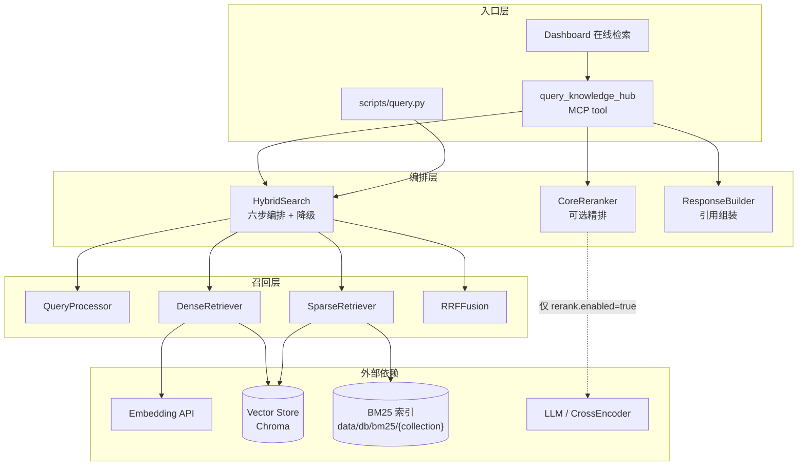
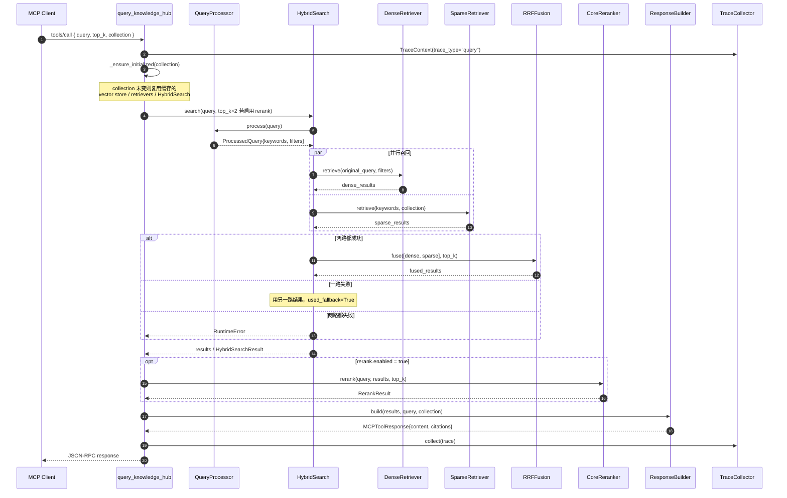
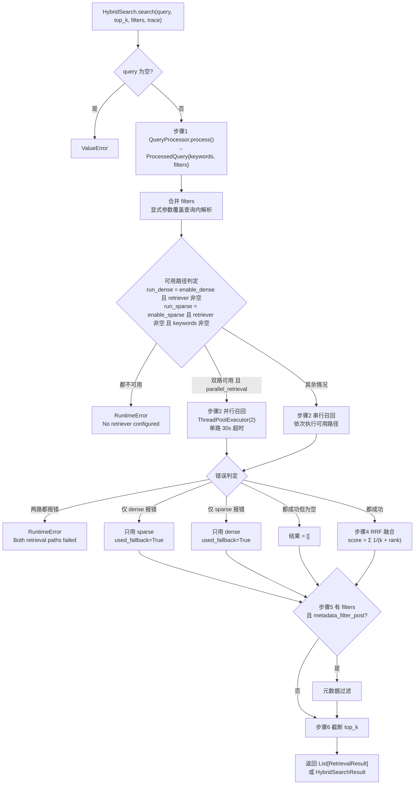
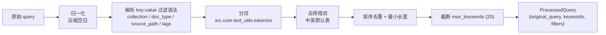
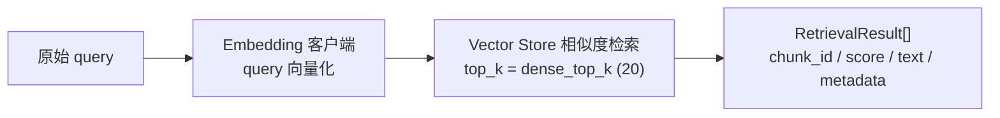
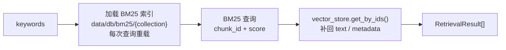
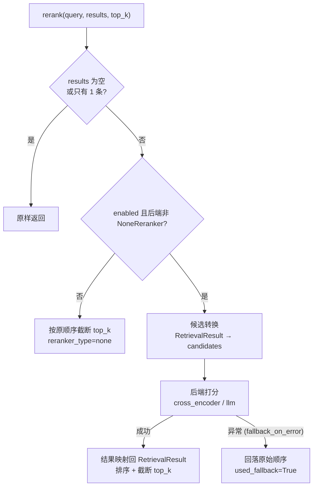

# 在线查询链路（query_engine）

用户查询 → 混合检索（Dense + Sparse）→ RRF 融合 → 元数据过滤 → （可选）重排序 → 响应的完整在线服务链路。

> 检索之前的意图识别 / 路由 / 查询改写见 [`planner/README.md`](planner/README.md)。
> 本链路接收的是 planner 产出的查询；planner 尚未接入 MCP 工具时，直接接收原始 query。

---

## 入口与调用方

| 入口 | 位置 | 说明 |
|---|---|---|
| MCP 工具 | `src/mcp_server/tools/query_knowledge_hub.py` → `execute()` | 线上主入口。按 collection 初始化组件并缓存，检索后按配置重排序，交给 `ResponseBuilder` 组装引用 |
| 命令行 | `scripts/query.py` | 不走 MCP，手动组装 `QueryProcessor + Dense/SparseRetriever + HybridSearch`，`--verbose` 打印中间结果 |
| Dashboard | 在线检索页 | 复用 MCP 检索链路 |

## 分层架构



## 一次请求的完整时序



缓存策略（`QueryKnowledgeHubTool._ensure_initialized`）：

- **永不失效**：embedding 客户端、reranker、query processor、settings
- **collection 变化才重建**：vector store、dense retriever、hybrid search
- **每次查询重载**：BM25 索引（`SparseRetriever._ensure_index_loaded()` 每次从磁盘读，保证 Dashboard 新摄入的数据立即可见）

---

## 六步流程（`hybrid_search.py` 的 `search()`）



### 1. 查询处理（`query_processor.py`）



- 分词**与索引侧 SparseEncoder 必须一致**，否则 BM25 匹配失效
- 同一份 keywords 供 sparse 检索，dense 检索用原始 query

#### filter 语法：什么情况下返回 filters

只有查询串里出现 `key:value`（正则 `(\w+):([^\s]+)`）且 `enable_filter_parsing=True`（默认）时才会返回非空 `filters`。命中片段会从查询里删掉，不参与分词。

| 输入 | filters | 说明 |
|---|---|---|
| `collection:docs 如何配置` | `{"collection": "docs"}` | `col` / `c` 是别名 |
| `type:pdf 接线` | `{"doc_type": "pdf"}` | `doc_type` / `t` 是别名 |
| `source:manuals 报错` | `{"source_path": "manuals"}` | `src` / `s` 是别名 |
| `tag:api,sdk 认证` | `{"tags": ["api", "sdk"]}` | 逗号分隔，重复出现累加 |
| `author:zhang 什么配置` | `{"author": "zhang"}` | 未知 key 原样透传 |

白话提问**不会**产生 filters：

- `"FAQ 里的退货政策是什么"` → `{}`
- `"只查产品手册中防水等级"` → `{}`

两个坑：

1. **URL / 时间会被误解析**：`https://example.com 怎么配置` → `{"https": "//example.com"}`；`10:30 的日志` → `{"10": "30"}`
2. **同名 key 后者覆盖前者**（`collection:a collection:b` → `b`），只有 `tags` 累加；`tag:a,` 尾逗号会产生空字符串元素

返回后由 `HybridSearch._merge_filters` 与显式 `filters` 参数合并（**显式优先**），再传给两路检索和融合后的 metadata 过滤。

> 限制集合更推荐用工具参数 `collection`（`query_knowledge_hub(collection="faq")`），不依赖字符串解析，也不会被 URL 误伤。

### 2a. 稠密检索（`retriever/dense_retriever.py`）



- 抓语义：能召回不含原词但意思相近的 chunk

### 2b. 稀疏检索（`retriever/sparse_retriever.py`）



- `top_k` 默认 `settings.retrieval.sparse_top_k`（20）
- 抓关键词：型号、缩写、专有名词这类语义模型容易漏的内容
- 无 keywords 时直接返回空（不算失败），索引缺失时 warn 并返回空

### 3. 降级矩阵

| dense | sparse | 行为 |
|---|---|---|
| ✅ | ✅ | RRF 融合 |
| ❌ | ✅ | 只用 sparse，`used_fallback=True` |
| ✅ | ❌ | 只用 dense，`used_fallback=True` |
| ❌ | ❌ | 抛 `RuntimeError`（两路错误信息都在异常里） |
| 成功但为空 | 成功但为空 | 返回空列表 |

`return_details=True` 时返回 `HybridSearchResult`，含 `dense_results / sparse_results / dense_error / sparse_error / used_fallback / processed_query`，调试和坏例分析用。

### 4. RRF 融合（`fusion.py`）

```
RRF_score(d) = Σ 1 / (k + rank(d))     # k 默认 60
```

- 只用排名不用原始分，规避向量分与 BM25 分不可比的问题
- 只出现在一路结果里的 chunk 也会贡献分数
- 相同分数按 `chunk_id` 决胜，保证确定性
- 只有一路结果时直接截断返回，不做融合

### 5. 元数据过滤

融合后的回退过滤（`metadata_filter_post`），匹配规则：

| key | 规则 |
|---|---|
| `collection` | 匹配 `metadata.collection` 或 `metadata.source_collection` |
| `doc_type` | 精确匹配 |
| `tags` | 列表取交集，非空即通过 |
| `source_path` | 子串匹配 |
| 其他 | 精确匹配 |

### 6. 重排序（`reranker.py`，可选）



- 后端三选一：`none`（默认）/ `cross_encoder` / `llm`
- 重排序失败不阻断链路，`RerankResult.used_fallback` / `fallback_reason` 可观测
- 工具层在启用重排序时用 `top_k × 2` 做初始召回，给精排留余量
- 打点 stage `rerank`：provider、输入/输出条数、chunk 快照

---

## 配置（`config/settings.yaml`）

```yaml
retrieval:
  dense_top_k: 20     # 稠密召回条数
  sparse_top_k: 20    # BM25 召回条数
  fusion_top_k: 10    # 融合后条数
  rrf_k: 60           # RRF 平滑常数
  enable_dense: true         # 关闭则跳过向量检索
  enable_sparse: true        # 关闭则跳过 BM25 检索
  parallel_retrieval: true   # 双路并行；false 时串行
  metadata_filter_post: true # 融合后按 metadata 过滤

rerank:
  enabled: false
  provider: "none"    # none / cross_encoder / llm
  model: "cross-encoder/ms-marco-MiniLM-L-6-v2"
  top_k: 5
```

工厂函数会把 settings 映射进各组件的 `*Config`；不传 settings 时全部用默认值，便于单测。

---

## Trace 打点

`HybridSearch` 与工具层通过 `TraceContext.record_stage()` 记录：

| stage | 记录内容 |
|---|---|
| `initialization` | collection、冷启动判断（>500ms） |
| `query_processing` | 原始 query、keywords |
| `dense_retrieval` | provider、top_k、命中数、chunk 快照（id/score/text/source） |
| `sparse_retrieval` | keyword 数、top_k、命中数、chunk 快照 |
| `fusion` | 输入列表数、top_k、融合后 chunk 快照 |
| `rerank` | provider、输入/输出条数、chunk 快照 |

最终由 `TraceCollector` 落盘到 JSONL，供 Dashboard 与评估模块消费。

---

## 目录

```
query_engine/
├── query_processor.py        # 步骤1：分词/停用词/filter 语法解析
├── hybrid_search.py          # 编排入口：六步流程 + 降级
├── fusion.py                 # 步骤4：RRF
├── reranker.py               # 可选精排（CoreReranker + 工厂）
├── retriever/
│   ├── dense_retriever.py    # 步骤2a：Embedding → 向量检索
│   └── sparse_retriever.py   # 步骤2b：BM25 → vector store 补全
└── planner/                  # 检索之前的意图/路由/改写（见其 README）
```

---

## 手动组装

```python
from src.core.query_engine.hybrid_search import create_hybrid_search
from src.core.query_engine.query_processor import QueryProcessor
from src.core.query_engine.retriever.dense_retriever import create_dense_retriever
from src.core.query_engine.retriever.sparse_retriever import create_sparse_retriever
from src.ingestion.storage.bm25_indexer import BM25Indexer
from src.libs.embedding.embedding_factory import EmbeddingFactory
from src.libs.vector_store.vector_store_factory import VectorStoreFactory

embedding = EmbeddingFactory.create(settings)
store = VectorStoreFactory.create(settings, collection_name="default")

hybrid = create_hybrid_search(
    settings=settings,
    query_processor=QueryProcessor(),
    dense_retriever=create_dense_retriever(settings, embedding, store),
    sparse_retriever=create_sparse_retriever(
        settings, BM25Indexer(index_dir="data/db/bm25/default"), store,
    ),
)

results = hybrid.search("BOM25 怎么接线", top_k=5, trace=trace)
```

## 测试

```bash
.venv/Scripts/python.exe -m pytest -q \
  tests/unit/test_query_processor.py \
  tests/unit/test_dense_retriever.py \
  tests/unit/test_fusion_rrf.py \
  tests/unit/test_llm_reranker.py
```

## 已知边界

- 融合后再做元数据过滤，靠前过滤可以让召回更准，后续可下沉到 retrieval 层
- RRF 只用排名，单路内部分差信息被丢弃；需要分数信息时可换加权融合
- 多查询召回（planner 的 `SUBQUERY` 模式）尚未接入，接入时可在本层对多路结果做二次 RRF