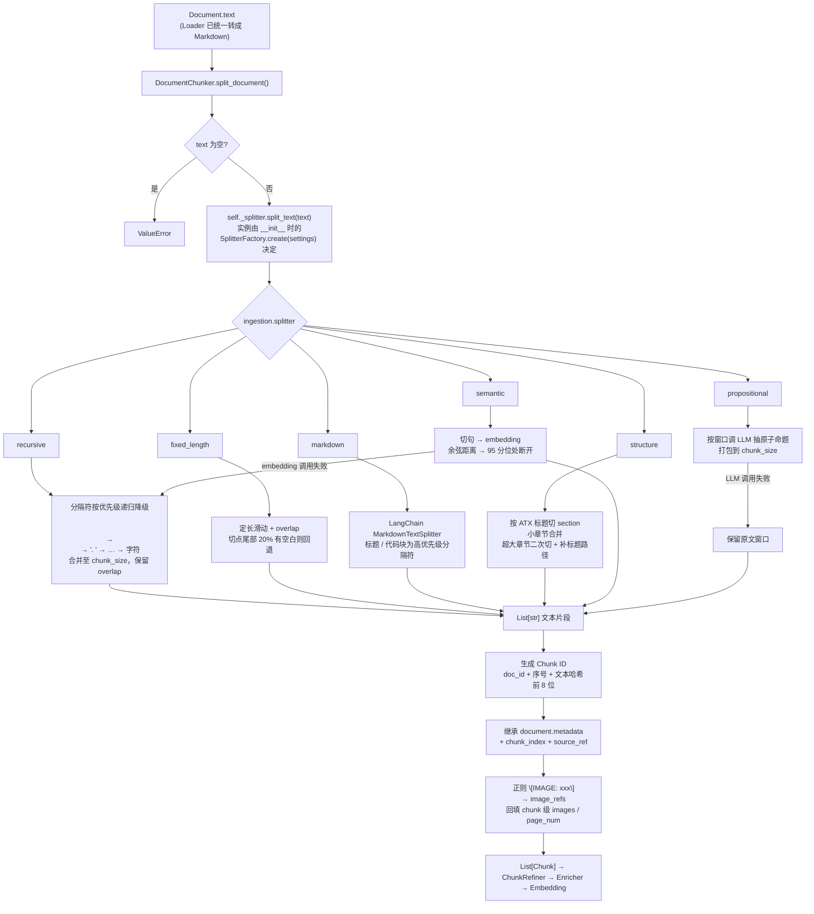
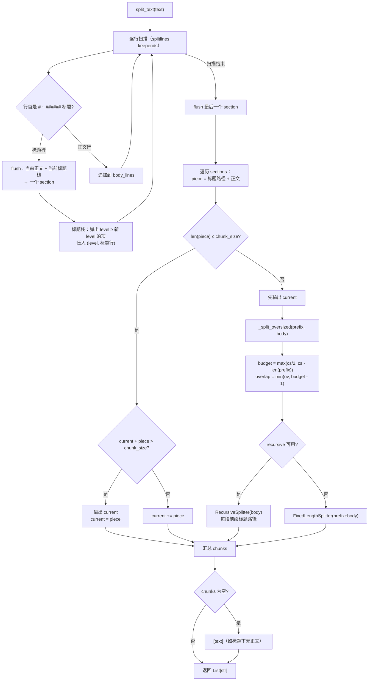
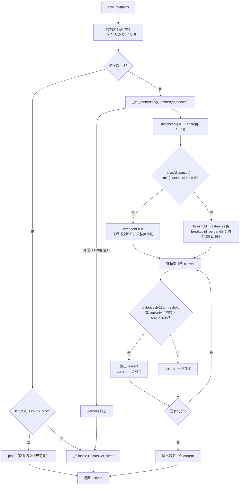

# 文档切分（Chunking）

本目录负责把 `Document` 切分为 `Chunk`。`DocumentChunker` 是适配层，实际切分算法在 `src/libs/splitter`，当前提供 6 种 provider。

## 模块总流程



工厂在 `DocumentChunker.__init__` 时选一次 provider，`split_document` 每次调用都走同一个；换策略要改配置并重建 pipeline。

## `split_document` 的职责

`DocumentChunker` 本身**不切分**，只做业务对象转换（`document_chunker.py:74`）：

1. 委托 `self._splitter.split_text(document.text)` 得到纯文本片段
2. 生成确定性 Chunk ID：`{doc_id}_{index:04d}_{sha256(text)[:8]}`
3. 继承 document 元数据，补充 `chunk_index`、`source_ref`
4. 从文本中提取 `[IMAGE: xxx]` 占位符 → `image_refs`，并按 ID 回填 chunk 级 `images`
5. 尝试用首个引用图片的 `page` 填充 `page_num`

同一 Document 重复切分结果完全一致（ID 确定、无随机性）。

## 默认策略：Recursive

配置项：`config/settings.yaml`

```yaml
ingestion:
  splitter: "recursive"   # recursive / fixed_length / markdown / semantic / structure / propositional
  chunk_size: 1000
  chunk_overlap: 200
```

分隔符按优先级依次尝试（`src/libs/splitter/recursive_splitter.py:42`）：

```
"\n\n" → "\n" → ". " → "! " → "? " → "; " → ", " → " " → ""
```

短文段会被合并回 `chunk_size` 以内，相邻 Chunk 保留 `chunk_overlap` 字符重叠。超过上限的段落自动降级到下一级分隔符。

> 已注册的 provider：`recursive`（默认）、`fixed_length`、`markdown`、`semantic`、`structure`、`propositional`（`splitter_factory.py:_register_builtin_providers`）。`markdown` 依赖 `langchain-text-splitters`，缺失时自动不注册。

各策略适用场景：

| provider | 适用 |
|---|---|
| `recursive` | 默认，混合格式通用 |
| `fixed_length` | 无结构纯文本、需要严格等长块的场景 |
| `markdown` | Markdown 文档，保护代码块与标题 |
| `structure` | Loader 输出的 Markdown（PDF/Office 均会转成 Markdown），按标题切章节、每块带标题路径 |
| `semantic` | 主题跨度大的长文，愿付一次 embedding 成本 |
| `propositional` | 高价值条款/FAQ，每块是 LLM 抽出的自包含原子命题，最贵 |

## StructureSplitter 结构化切分器内部流程

代码：`src/libs/splitter/structure_splitter.py`



关键点：

- **标题栈**决定"标题路径"：`# Root` + `## A` 下的正文，路径为 `# Root\n## A\n`，会原样拼到该 section 每个 Chunk 前面。
- **相邻小 section 会合并**（`current += piece`），避免每节只有一句话时产生大量碎片。
- **只有超大 section 才二次切分**；`budget` 给标题路径让位，路径比 chunk_size 一半还长时退回 `chunk_size//2`（`ponytail` 注释标记了这个兜底）。
- 无标题文本 = 一个 section（路径为空），本策略退化为"整段或按大小切"。

## SemanticSplitter 语义切分器内部流程

代码：`src/libs/splitter/semantic_splitter.py`



关键点：

- 断点阈值用**分位数**而不是固定值：默认 95 分位，只在最高的约 5% 语义跳变处断开；`breakpoint_percentile` 调小切得更碎。
- 距离全部相同（例如重复句式）时视为"无语义跳变"，`threshold = ∞`，避免每句都成一块。
- 单块大小用 `_join(current + [下一句]).length` 判断，保证 Chunk 不会因拼接空格而超出 `chunk_size`。
- 拼接规则：中文标点后不补空格（`。！？；，、`），其余补一个空格，尽量还原原文。
- **不产生 overlap**（`chunk_overlap` 在本策略中不生效），靠语义边界保证连贯。
- 两句以下或 embedding 失败 → 降级 `RecursiveSplitter`；降级也失败（缺 langchain）会把 `ImportError` 抛给调用方。

## 常见分块策略对比

| 策略 | 依据 | 优点 | 缺点 |
|---|---|---|---|
| Fixed-length | 固定字符/token 数 + overlap | 最简单、最快 | 硬切句子，语义断裂 |
| **Recursive**（默认） | 分隔符优先级递归降级 | 尽量保段落/句子完整，通用 | 不理解语义 |
| Sentence / Paragraph | 标点、空行 | 边界自然 | 块大小不可控 |
| Structure-aware | Markdown / HTML / 表格结构 | 保留文档层级 | 依赖原文结构化 |
| Semantic | embedding 相似度突变点 | 主题边界准 | 摄入阶段即需算 embedding，慢且贵 |
| Parent-child | 小块检索、大块喂 LLM | 检索精度 + 上下文兼顾 | 索引结构复杂 |
| LLM / Agentic | LLM 判断边界 | 质量最高 | 极慢极贵，不适合批量 |

## 为什么选 Recursive

- **格式通用**：LoaderFactory 支持 pdf/txt/md/csv/json/docx/pptx/xlsx/html，recursive 不需要为每种格式单独适配。
- **零 LLM 成本**：摄入阶段不调用模型，结果确定、可复现。
- **下游有兜底**：Pipeline 后续还有 `ChunkRefiner`（LLM 精炼）和 `MetadataEnricher`，语义质量可在那里补齐。
- **可替换**：`BaseSplitter` + `SplitterFactory.register_provider` 已留好扩展口，加新策略不需要改上游代码。

## 已知问题

1. **中文切分不理想**：默认分隔符里的 `. ` `! ` `? ` 是带空格的英文句末标点，中文几乎不命中，长中文段落会一路降级到 `" "` 甚至按字符切。建议注册一个分隔符包含 `。！？；` 的版本。
2. **recursive 会切断代码块**：其分隔符列表里没有 ` ``` ` 和 `# `。需要保护代码块/章节时改用 `markdown` 或 `structure`。

## 新增策略的方式

```python
# 1. 实现 src/libs/splitter/<your>_splitter.py
class MySplitter(BaseSplitter):
    def split_text(self, text, trace=None, **kwargs) -> list[str]: ...

# 2. 在 splitter_factory._register_builtin_providers() 中注册
SplitterFactory.register_provider("my", MySplitter)

# 3. 改配置
ingestion:
  splitter: "my"
```

`DocumentChunker` 无需任何改动。