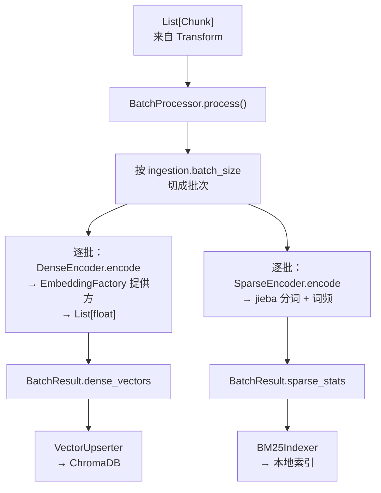
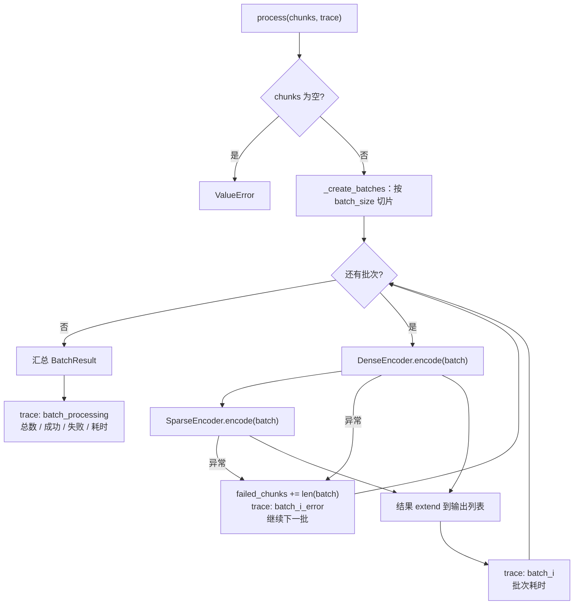
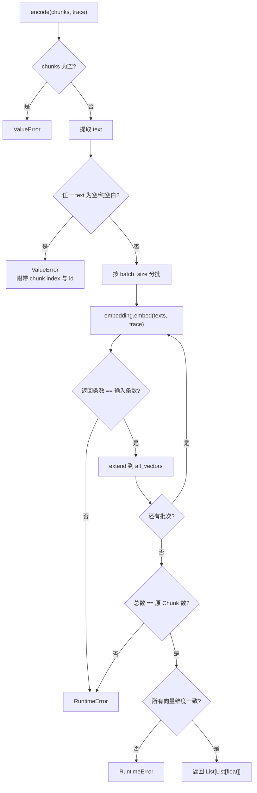

# Embedding 编码层

本目录是 Pipeline 的阶段 5（`pipeline.py:382-457`），把 Transform 后的 `Chunk` 编码成两套表示：

- **稠密向量**：调 Embedding API，供向量库做语义检索
- **稀疏统计**：BM25 词项统计（本地计算，不调 API），供关键词检索



| 组件 | 输入 | 输出 | 是否调外部 API |
|---|---|---|---|
| `DenseEncoder` | `List[Chunk]` | `List[List[float]]`，与 Chunk 一一对应 | 是（Embedding 提供方） |
| `SparseEncoder` | `List[Chunk]` | `List[Dict]` 词项统计，与 Chunk 一一对应 | 否 |
| `BatchProcessor` | `List[Chunk]` | `BatchResult`（两套结果 + 指标） | 间接（通过 DenseEncoder） |

共同约定：输出顺序与输入 Chunk 顺序严格一致；相同输入产生相同输出（稠密取决于模型本身的确定性）。

## BatchProcessor 内部流程

代码：`batch_processor.py`



`BatchResult` 字段：

| 字段 | 含义 |
|---|---|
| `dense_vectors` | 成功批次的稠密向量（注意：失败批次的 Chunk 不在其中） |
| `sparse_stats` | 成功批次的词项统计 |
| `batch_count` | 批次数 |
| `total_time` | 总耗时（秒） |
| `successful_chunks` / `failed_chunks` | 计数 |

顺序上每批内**先稠密后稀疏**（不是并行）；两类编码本身互不依赖，串行只是实现上的简单选择。

### 双层分批

`BatchProcessor` 先按 `batch_size` 切一次，`DenseEncoder` 内部又按自己的 `batch_size` 切一次。Pipeline 里两者用同一个值（`pipeline.py:168-178`，来自 `ingestion.batch_size`），所以实际等价于只分一次；单独使用这两个类时才会叠加。

## DenseEncoder 内部流程

代码：`dense_encoder.py`



行为约定：

- **无重试**：提供方任何异常直接包装成 `RuntimeError("Failed to encode batch a-b: ...")` 抛出，没有退避/重试。
- **维度**由 Embedding 提供方决定（`settings.embedding.model` / `dimensions`）。`dimensions` 只对 `text-embedding-3-*` 作为 API 参数生效，`ada-002` 忽略。
- `trace` 原样转交给提供方，本类不记录自己的 trace。
- `get_batch_count(n)` 只是给日志/进度用的辅助方法。

## SparseEncoder 内部流程

代码：`sparse_encoder.py`

词项统计对每个 Chunk：

```python
{
    "chunk_id": "doc_xxx_0000_abcd1234",
    "term_frequencies": {"machine": 2, "learning": 1},  # 词项 → 出现次数
    "doc_length": 3,                                    # 词项总数
    "unique_terms": 2,                                  # 词表大小
}
```

分词链路（`encode → _tokenize`）：

1. 调 `src/core/text_utils.tokenize`（jieba 切分中英文，保留 `GPT-4`、`machine-learning` 这类连写词）
2. `lowercase=True` 时全部转小写
3. 丢弃长度 < `min_term_length`（默认 2）的词项

**分词必须与查询侧一致**，否则 BM25 匹配不上：查询侧 `QueryProcessor._tokenize` 用同一个 `shared_tokenize`，`BM25Indexer.search` 在检索时会再对查询词做一次 `lower()`（`bm25_indexer.py:257`），与索引侧的小写化对齐。

`get_corpus_stats(encoded_chunks)` 计算语料级统计：`num_docs`、`avg_doc_length`、`document_frequency`（词项 → 包含它的文档数）。**目前没有被调用** —— `BM25Indexer.build_index` 自己从 `term_frequencies` 重算 `N` / `avg_doc_length` / `DF`（`bm25_indexer.py:141-177`），这个方法属于预留/测试用工具。

## 配置

```yaml
embedding:
  provider: "openai"            # openai / azure / ollama
  model: "text-embedding-ada-002"
  dimensions: 1536              # ada-002 固定维度；text-embedding-3-* 会传给 API

ingestion:
  batch_size: 100               # BatchProcessor 与 DenseEncoder 共用
```

## 失败语义与可观测字段

`trace.record_stage` 记录的阶段：

| stage | 内容 |
|---|---|
| `batch_{i}` | 该批 `batch_size`、`duration_seconds` |
| `batch_{i}_error` | 该批异常信息 |
| `batch_processing` | 总 Chunk 数、批次数、成功/失败数、总耗时 |
| `embed`（Pipeline 层） | 向量数、维度、每个 Chunk 的 `doc_length` / `unique_terms` / Top-10 词项 |

**「单批失败继续」约定只在 BatchProcessor 内部成立**：它吞掉异常继续下一批，结果是失败批次的向量/统计直接缺失、输出列表与 Chunk 不再对齐。Pipeline 在 `pipeline.py:400-415` 检查 `failed_chunks > 0` 并直接抛 `RuntimeError`，避免把错位结果写进向量库。也就是说实际摄入行为是**整篇文档编码失败**，没有逐 Chunk 降级。

## 已知注意点

1. **空文本会炸整篇文档**：两个 encoder 都对空/纯空白 `chunk.text` 抛 `ValueError`（`dense_encoder.py:103-108`、`sparse_encoder.py:109-114`）。上游 `ChunkRefiner` 的规则清洗可能把 Chunk 洗成空串，Transform 之后没有过滤空 Chunk —— 见 `transform/README.md` 的说明。
2. **无重试**：Embedding API 偶发 429/超时会让该批次失败，进而整篇文档失败；批量摄入建议关注提供方限流。
3. **类注释与实际不符**：`batch_processor.py:51` 写「并行编码」，实际 dense/sparse 在同一批次内串行执行。
4. **失败批次没有兜底**：`BatchResult` 本身不保证与输入对齐，直接消费 `BatchResult` 的调用方需要自己核对 `successful_chunks` 与列表长度。
5. **停用词**：`SparseEncoder` 默认不做停用词过滤（只按最小长度过滤）；查询侧 `QueryProcessor` 有自己的停用词表，两侧不完全对称，但 BM25 打分只依赖索引侧统计，影响有限。