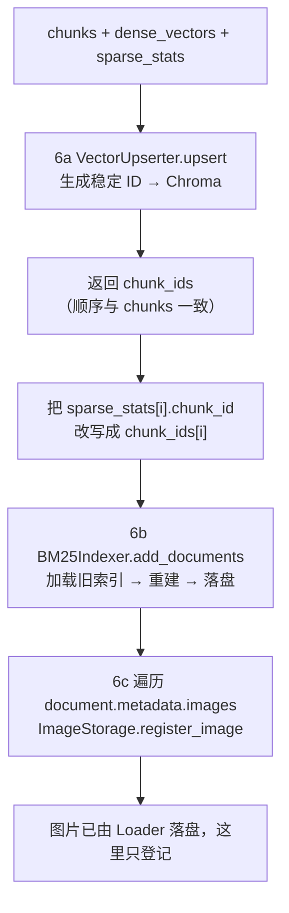
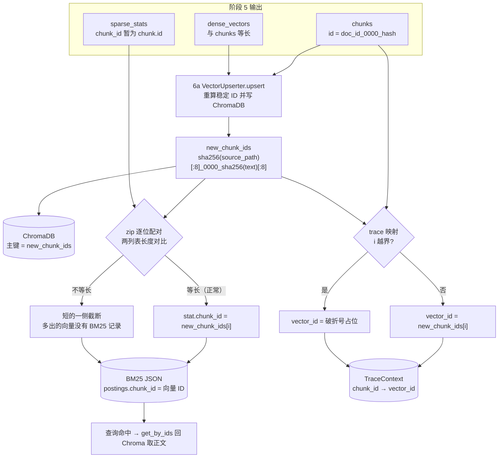

# Storage 存储层

本目录是 Pipeline 的阶段 6（`pipeline.py:455-540`），把编码结果落到三个后端：

| 组件 | 后端 | 存什么 | 位置（默认） |
|---|---|---|---|
| `VectorUpserter` | ChromaDB（可插拔 VectorStore） | 稠密向量 + Chunk 元数据 + 正文 | `data/db/chroma`，collection 名来自配置 |
| `BM25Indexer` | 本地 JSON 倒排索引 | 词项的 IDF / DF / 倒排表（tf、doc_length） | `data/db/bm25/{collection}/{collection}_bm25.json` |
| `ImageStorage` | 文件系统 + SQLite | 图片文件 + `image_id → 路径/页码` 索引 | 文件 `data/images/...`，索引 `data/db/image_index.db` |



三个后端的写入**没有事务**：6a 成功、6b 失败时，Chroma 里的向量不会回滚（重跑时靠稳定 ID 幂等覆盖）。

## 写入口径与 ID 对齐

`VectorUpserter` **不使用** `chunk.id`，而是自己生成主键（`vector_upserter.py:141-170`）：

```
{sha256(source_path)[:8]}_{chunk_index:04d}_{sha256(chunk.text)[:8]}
```

- 同一文档、同样内容重复摄入 → 相同 ID → Chroma `upsert` 覆盖，幂等
- 文本变了（例如 Refiner/Enricher 调整内容）→ 新 ID → 旧向量残留

BM25 只存词项统计、不存正文，检索后要拿 `chunk_id` 回 Chroma 取原文，所以 Pipeline 在 6b 前统一改写（`pipeline.py:467-470`）：

```python
for stat, vid in zip(sparse_stats, chunk_ids):
    stat["chunk_id"] = vid
```

不这样做，`SparseRetriever` 的 `vector_store.get_by_ids()` 会查不到（详见 `sparse_retriever.py:171-173`）。



## 落盘细节（阶段 6 调用链）

`pipeline.py:467-498` 三段代码里，`zip` 循环不写任何库，真正落盘的是 6b、6c。

### ID 对齐：只改内存

`sparse_stats` 是 `SparseEncoder` 产出的 `list[dict]`，`stat["chunk_id"] = vid` 是就地改字典字段，没有 I/O。改写后的列表原样交给 `add_documents`。

### 6b：BM25 → JSON 文件整份重写

```
add_documents(sparse_stats, collection, document.id)      bm25_indexer.py:310
├─ _validate_term_stats                                    # 要求 chunk_id / term_frequencies / doc_length
├─ if not self._index: self.load(collection)               # 读旧文件 {index_dir}/{collection}_bm25.json
├─ if doc_id and self._index: self.remove_document(doc_id) # 重复摄入去旧倒排（前缀匹配，见已知问题 1）
├─ 扫描旧 postings 反向还原 existing_stats                  # chunk_id → {term_frequencies, doc_length}
├─ combined = existing_stats + sparse_stats
└─ build(combined, collection)                             bm25_indexer.py:100
   ├─ N = chunk 数；avg_doc_length = 总词数 / N
   ├─ DF = 每个词项出现在多少个 chunk
   ├─ IDF = ln((N - df + 0.5) / (df + 0.5))
   ├─ 倒排表 term → {idf, df, postings: [{chunk_id, tf, doc_length}]}
   └─ _save(collection)                                    bm25_indexer.py:515
      ├─ mkdir -p data/db/bm25/{collection}/
      ├─ json.dump → xxx_bm25.tmp（ensure_ascii=False）
      └─ tmp.replace(正式文件)                              # 原子替换
```

- BM25 没有数据库，「增量」= 读旧 → 合并 → 全量重算 → 整个文件重写。
- 落盘的 `chunk_id` 是 `new_chunk_ids`（`sha256(source_path)[:8]_...`），检索时靠它回 Chroma 取正文。
- `doc_id=document.id` 传的是 `doc_{文件哈希}`，与倒排前缀不匹配，`remove_document` 实际删不掉 —— 见已知问题 1。

### 6c：图片 → SQLite 一行，文件早就在磁盘上

图片文件不是这里写的：Loader（pdf/office/text）在阶段 1 已存到 `data/images/{collection}/{doc_hash}/{image_id}.{ext}`，路径记在 `document.metadata["images"]`。这里只建索引：

```
if img_path.exists():                       # 文件缺失就跳过，不报错
    register_image(...)                     image_storage.py:230
    ├─ path.exists() 校验
    ├─ stored_path = path.resolve()         # 存绝对路径
    └─ INSERT OR REPLACE INTO image_index
       (image_id, file_path, collection, doc_hash, page_num, created_at)
       → commit → close                     # 每次操作开独立连接
```

DB 文件是 `data/db/image_index.db`（WAL 模式），`image_id` 主键，重复登记覆盖。

### 三处写入对照

| 步骤 | 后端 | 写入动作 | 幂等性 |
|---|---|---|---|
| 6a 向量 | ChromaDB | upsert 向量 + metadata | 稳定 ID 覆盖 |
| 6b BM25 | JSON 文件 | 整份读-合并-原子重写 | 依赖 `remove_document`（见已知问题 1） |
| 6c 图片 | SQLite | `INSERT OR REPLACE` 一行 | `image_id` 主键覆盖 |

## VectorUpserter

代码：`vector_upserter.py`（205 行）

- 构造：`VectorStoreFactory.create(settings, collection_name=...)`，collection 可由参数覆盖配置
- `upsert(chunks, vectors, trace)`：
  1. 校验 `len(chunks) == len(vectors)` 且非空
  2. 逐条生成 ID、组装记录
  3. 一次性调用 `vector_store.upsert(records)`
  4. 返回 ID 列表；任何存储异常包装成 `RuntimeError`
- 记录结构：

```python
{
    "id": chunk_id,
    "vector": [...],
    "metadata": {**chunk.metadata, "text": chunk.text, "chunk_id": chunk_id},
}
```

`text` 存进 metadata 是为了检索时不用再读原文件；Chroma 同时把 `text` 写进 `documents` 字段（`chroma_store.py:187`）。

- `upsert_batch(batches)`：把多个 `(chunks, vectors)` 展平后一次写入，减少往返。

### Chroma 元数据的类型限制

Chroma 只接受 `str/int/float/bool`，`ChromaStore._sanitize_metadata`（`chroma_store.py:380-406`）的处理是：

- `None` → 丢弃
- `list/tuple` → `",".join(str(v))` 变成字符串
- 其他（dict 等）→ `str(value)`

影响：`chunk.metadata["images"]`（list of dict）、`tags`、`image_captions` 在**写入后读出时都是字符串**。查询侧 `multimodal_assembler.extract_image_refs` 用 `isinstance(images_list, list)` 判断（`multimodal_assembler.py:181`），所以结构化图片字段实际不会命中，会回退到扫描正文占位符 + `ImageStorage.get_image_path()`。见「已知问题」。

## BM25Indexer

代码：`bm25_indexer.py`（545 行）

### 索引结构

`{index_dir}/{collection}_bm25.json`：

```json
{
  "metadata": {"num_docs": 12, "avg_doc_length": 85.3, "total_terms": 1432, "collection": "knowledge_hub"},
  "index": {
    "machine": {
      "idf": 2.31,
      "df": 4,
      "postings": [
        {"chunk_id": "a1b2c3d4_0000_e5f6g7h8", "tf": 3, "doc_length": 120}
      ]
    }
  }
}
```

### 打分公式

```
IDF(t)     = ln((N - df + 0.5) / (df + 0.5))
score(t,d) = IDF(t) * tf * (k1 + 1) / (tf + k1 * (1 - b + b * doc_length / avg_doc_length))
```

- `k1=1.5`（词频饱和）、`b=0.75`（长度归一化），构造参数可调
- 多词项查询分数累加；`query()` 返回 `[{"chunk_id", "score"}]` 按分数降序、截断 `top_k`
- 查询词会先 `lower()`（`bm25_indexer.py:257`），与 `SparseEncoder` 建索引时的小写化对齐
- 公式不带 `+1` 平滑，词项出现在超过一半文档时 IDF 为负；单文档语料所有分数都是负数（排序仍有效）

### 方法

| 方法 | 行为 |
|---|---|
| `build(term_stats, collection)` | 从头算 N/avg_dl/DF/IDF、建倒排表、原子落盘（写 `.tmp` 再 `replace`） |
| `load(collection)` | 读 JSON；文件不存在返回 `False`；JSON 损坏抛 `ValueError` |
| `query(query_terms, top_k)` | 内存索引打分；未加载/空查询抛 `ValueError` |
| `add_documents(term_stats, collection, doc_id)` | 增量摄入：加载旧索引 → 可选移除 `doc_id` 前缀的旧倒排 → 从旧倒排反向还原统计 → 合并新统计 → 全量重建 |
| `remove_document(doc_id, collection)` | 删除 `chunk_id.startswith(doc_id)` 的倒排，清空词项，重算 DF/IDF/avg_dl 后落盘 |
| `rebuild(...)` | `build` 的别名 |

`add_documents` 的"增量"本质是**读旧索引、合并、全量重算**，不是原地追加；文档数多时每次摄入都是 O(整个索引)。

### 查询侧

MCP 查询工具每次请求**新建**一个 `BM25Indexer` 并 `load()`（`query_knowledge_hub.py:198`），没有进程内缓存 —— 索引文件大时这是可优化点。`SparseRetriever` 用它拿到 `chunk_id` 后回 Chroma 取正文（`sparse_retriever.py:171-173`）。

## ImageStorage

代码：`image_storage.py`（469 行）

### SQLite Schema

```sql
image_index (
    image_id   TEXT PRIMARY KEY,
    file_path  TEXT NOT NULL,      -- 存的是绝对路径
    collection TEXT,
    doc_hash   TEXT,
    page_num   INTEGER,
    created_at TEXT NOT NULL
)
-- 索引: idx_collection(collection), idx_doc_hash(doc_hash)
```

- 初始化时 `PRAGMA journal_mode=WAL`，每个操作开独立连接（短连接、用完即关），WAL 允许读写并发
- 数据库是**全局单文件**，不按 collection 分库；靠 `collection` 字段过滤

### 两个写入方法

| 方法 | 用途 | 是否移动文件 |
|---|---|---|
| `save_image(image_id, bytes 或 Path, collection, doc_hash, page_num, extension)` | 全权托管图片 | 是：复制到 `{images_root}/{collection}/{image_id}.{ext}` |
| `register_image(image_id, file_path, collection, doc_hash, page_num)` | 图片已由其他组件落盘，只登记索引 | 否，只校验文件存在并写 DB |

**Pipeline 用的是 `register_image`**（`pipeline.py:490-495`）：PDF/Office/Markdown Loader 已经把图片写到 `data/images/{collection}/{doc_hash}/{image_id}.{ext}`，这里只建索引。注意这与本类 docstring 里写的 `data/images/{collection}/{image_id}.png` 不同 —— 两种布局并存，实际路径以 Loader 写入的为准。

### 其他方法

- `get_image_path(image_id)` / `image_exists(image_id)`
- `list_images(collection=..., doc_hash=...)`：按 `created_at` 升序
- `delete_image(image_id, remove_file=True)`：先查路径，删 DB 行，再删文件（删文件失败静默忽略）
- `get_collection_stats(collection)`：图片数与总字节数
- 所有写入都是 `INSERT OR REPLACE`，同 ID 重复登记幂等

## 查询侧读取方式

| 检索路径 | 读存储的方式 |
|---|---|
| 稠密 | Chroma `query(vector)` → 直接拿到 `documents` / `metadata` |
| 稀疏 | BM25 `query(keywords)` → `chunk_id` → `vector_store.get_by_ids()` 回表 |
| 图片 | metadata.images（实际是字符串）→ 失败则回退正文 `[IMAGE: id]` → `ImageStorage.get_image_path()` 或约定路径 |

## 配置与数据目录

```yaml
vector_store:
  provider: "chroma"
  persist_directory: "./data/db/chroma"
  collection_name: "knowledge_hub"
```

BM25 与 ImageStorage 的路径不在配置里，由 Pipeline 硬编码拼出（`pipeline.py:186-192`）：

```
data/db/bm25/{collection}/{collection}_bm25.json
data/db/image_index.db
data/images/{collection}/{doc_hash}/{image_id}.{ext}
```

## 已知问题

1. **BM25 重复摄入会累积倒排记录（已实测）**：`add_documents(..., doc_id=document.id)`（`pipeline.py:477`）和 `DocumentManager.delete_document` 的 `remove_document(source_hash, ...)` 传的前缀都与实际 `chunk_id` 不匹配 —— 倒排里的 ID 是 `sha256(source_path)[:8]_...`，`document.id` 是 `doc_{file_hash[:16]}`，文件内容哈希是另一套 64 位值。`remove_document` 用 `startswith` 匹配，永远删不掉。实测同一文档重复摄入后同一 `chunk_id` 的倒排出现两次，检索分数被重复累加。修复方向：移除时传 `sha256(source_path)[:8]`，或在统计里额外保留原始 `chunk.id` 供删除/溯源使用。
2. **BM25 实例的索引缓存跨 collection 串味**：`self._index` 只在为空时 `load(collection)`；同一实例先处理 A collection 再 `add_documents(B)`，会拿 A 的内存索引写进 B 的文件。Pipeline 按 collection 各建实例所以不触发，但作为库 API 是个坑。
3. **Chroma 把列表元数据压成字符串**：`images` / `image_captions` / `tags` 写入后读出来是 `"{'id': ...},..."` 这样的字符串，`multimodal_assembler` 的结构化图片分支永远不会命中，只能走占位符 + ImageStorage 回退；`image_captions` 也因此不会挂到返回的引用上（描述已在 Chunk 正文里）。
4. **文本变化导致向量孤儿**：Chroma 主键含内容哈希，Refiner 重新处理同一文件后文本不同即生成新 ID，旧向量既不被覆盖也不被删除，除非先走 `DocumentManager.delete_document(source_path)`。
5. **ImageStorage 存绝对路径**：整体移动 `data/images` 或换机器后，SQLite 里的记录全部失效（文件仍在，但索引指不到）。
6. **`image_id` 全局唯一但图片按 collection 分目录**：同一文档摄入到两个 collection 时 `image_id` 相同（`{doc_hash[:8]}_0_1`），第二次 `register_image` 会把 DB 行的 `collection` 覆盖成后者，前一个 collection 只能靠 Chunk 元数据里的路径取图。
7. **阶段 6 无事务**：6a 成功、6b/6c 抛错时向量已写入，重跑才能补齐；`register_image` 的异常（DB 故障）会直接让整个 Pipeline 失败，但此时 Chroma/BM25 已落盘。
8. **单文档语料 IDF 为负**：BM25 原始公式天然如此，语料规模小时分数可能全为负，排序不受影响，但不要拿绝对值当相关性阈值。