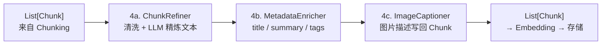
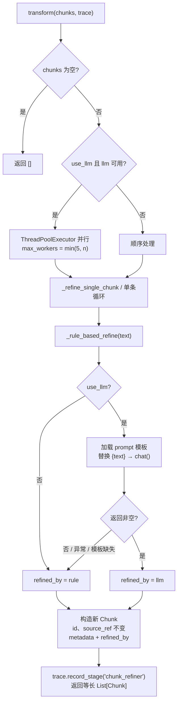
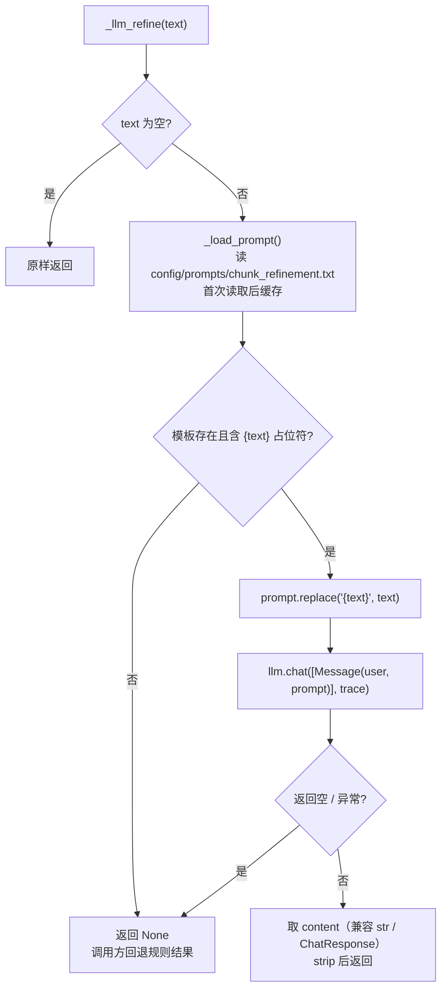
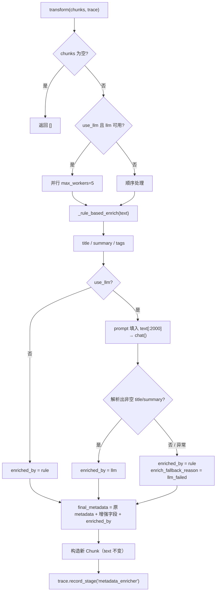
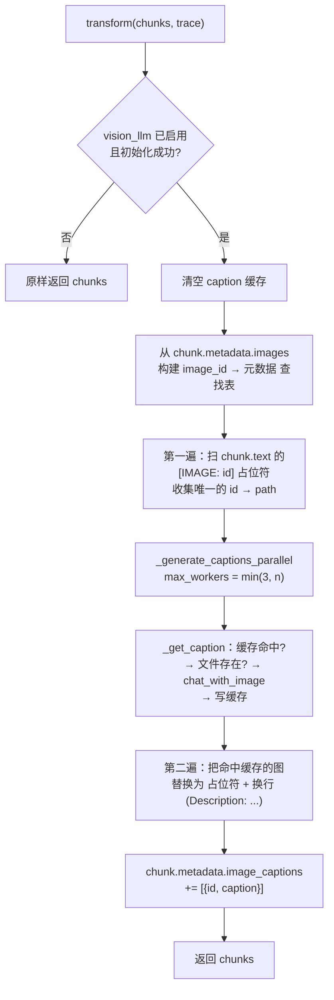

# Transform 变换层

本目录在切分之后、向量化之前对 `Chunk` 做增强，是 Pipeline 的阶段 4（`pipeline.py:323-377`）：



顺序是固定的：精炼先改文本，元数据基于精炼后的文本生成；图片描述最后追加，所以 `summary` 不包含图片描述。三个变换**逐个 Chunk 原子处理**，单个 Chunk 失败只记录日志，不阻塞整篇文档。

| 组件 | 输入/输出 | 规则路径（始终执行） | LLM 路径（可选） | 失败行为 |
|---|---|---|---|---|
| `ChunkRefiner` | 文本 → 文本 | 去页眉页脚/HTML/多余空白，保护代码块 | `config/prompts/chunk_refinement.txt` | 回退规则结果，标记 `refined_by=rule` |
| `MetadataEnricher` | 文本 → 元数据 | 标题/摘要/标签启发式提取 | `config/prompts/metadata_enrichment.txt` | 回退规则结果，标记 `enriched_by=rule` |
| `ImageCaptioner` | 图片路径 → 描述 | 提取 `[IMAGE: id]`、缓存、占位符替换 | Vision LLM（`chat_with_image`） | 跳过该图片，Chunk 保持原样 |

共同约定（`BaseTransform`）：`transform(chunks, trace) -> List[Chunk]`，返回长度与输入一致；变换结果写入 `chunk.metadata`，并在 `trace` 中记录阶段统计。

## 配置

`config/settings.yaml`：

```yaml
ingestion:
  chunk_refiner:
    use_llm: true          # false 或 LLM 初始化失败 → 只走规则
  metadata_enricher:
    use_llm: true

vision_llm:
  enabled: true            # false → ImageCaptioner 直接原样返回
```

`prompt_path` 可通过两个变换的构造参数覆盖，默认读 `config/prompts/*.txt`。

## ChunkRefiner 内部流程

代码：`chunk_refiner.py`



### 规则清洗（`_rule_based_refine`）

始终执行、无外部依赖的确定性清洗，负责"能确定的事"；LLM 只在这份结果上做语义级修补。

执行顺序（顺序本身有含义）：

| # | 操作 | 实现 |
|---|---|---|
| 0 | 空文本直接返回；纯空白返回 `""` | `if not text` / `if not text.strip()` |
| 1 | 抽出 ` ``` ` 代码块，替换为 `__CODE_BLOCK_i__` | 先保护，避免被后续正则破坏 |
| 2 | 删除带 `Page N` / `Footer` / `Section N` / `©` / `Confidential` 的分隔线 | `─{10,}.*?(?:Page \d+\|Footer\|…).*?─{10,}`（DOTALL） |
| 3 | 删除剩余 `─{10,}` 分隔线 | `─{10,}` |
| 4 | 删除 HTML 注释 | `<!--.*?-->`（DOTALL） |
| 5 | 删除 HTML 标签，保留标签内文字 | `<[^>]+>` |
| 6 | 多个空格合一 | ` {2,}` → ` ` |
| 7 | 3 个及以上连续换行压成 2 个（保留段落） | `\n{3,}` → `\n\n` |
| 8 | 去掉每行行尾空白 | 逐行 `rstrip()` |
| 9 | 恢复代码块 | `__CODE_BLOCK_i__` → 原文 |
| 10 | 最终 `strip()` | |

示例：

```
输入:  ────────────── Page 3 ──────────────
       <p>Hello</p>    world
       <!-- internal note -->
输出:  Hello world
```

局限（等价性是"在多数语料上大致成立"，不是保证）：

- 页眉页脚关键词是英文硬编码，中文页眉（"某某公司 第 3 页"）识别不了。
- `─{10,}` 全局删除，可能吃掉用横线排版的表格分隔行。
- HTML 标签删除不区分上下文，代码里的 `<T>` 也会被去掉（代码块已先保护，块外无法区分）。
- **清洗后可能变成空串**：如果 Chunk 内容全部是被删的元素（例如整块只有 HTML 注释/分隔线），`chunk.text` 会变成 `""`；下游 `DenseEncoder` / `SparseEncoder` 对空文本直接抛 `ValueError`（`dense_encoder.py:105`），会导致该文件后续编码阶段失败。目前没有在 Transform 后过滤空 Chunk。
- 幂等：对已清洗文本再跑一遍结果不变。

### LLM 精炼（`_llm_refine`）

规则清洗之后的可选语义层：修正则处理不了的问题（PDF 换行劈开的句子、被拍平的表格、重复页眉混入正文）。



契约与行为：

- 返回 `Optional[str]`：`None` = 没有可用的 LLM 结果，调用方使用规则结果并标记 `refined_by=rule`；**从不抛异常、从不返回空串**。
- 每个 Chunk 一次调用（并行 5 线程），不记录 token 用量；trace 只统计成功/回退数量。
- 送的是**全文**：`MetadataEnricher` 会截 `text[:2000]`，这里不做截断；`chunk_size=1000` 时无碍，调大 chunk 后要留意上下文长度。

prompt 模板（`config/prompts/chunk_refinement.txt`）的约束：

- 只许删除提取噪声、修复格式；禁止总结、增补、删减内容或改动专有名词
- **必须原样保留 `[IMAGE: id]` 占位符**
- 输出纯文本，不允许添加 Markdown（`#` / `**` / `-` 等）

## MetadataEnricher 内部流程

代码：`metadata_enricher.py`



规则启发式：

- **title**：Markdown 标题 → 短首行（≤100 字符且不以 `.` `,` `;` 结尾）→ 第一句（去句末标点，≤150 字符）→ 前 100 字符
- **summary**：前 3 句，最长 500 字符
- **tags**：首字母大写词组、camelCase/snake_case 标识符、Markdown 粗体/斜体词，去重后最多 10 个

LLM 路径要求响应为 `Title: ... / Summary: ... / Tags: a, b` 格式（`_parse_llm_response`）；解析失败时 title 兜底 `Untitled`、summary 兜底原始响应的前 500 字符。**LLM 元数据整体替换规则元数据**（不是字段级合并），再与 `chunk.metadata` 合并。

异常兜底：单 Chunk 抛出异常时仍产出 Chunk，元数据为 `title=Untitled / summary=文本前 100 字 / tags=[] / enriched_by=error`。

## ImageCaptioner 内部流程

代码：`image_captioner.py`



数据来源：

| 来源 | 内容 | 用途 |
|---|---|---|
| `chunk.text` | `[IMAGE: doc1_2_0]` 占位符 | 判断"这块引用了哪些图" |
| `chunk.metadata["images"]` | `[{"id", "path", "page", ...}]` | 拿到图片**文件路径**才能调 Vision API |
| `self._caption_cache` | `img_id → 描述` | 同一张图跨 Chunk 只调一次 API |

执行步骤：

1. **Vision 不可用直接返回**（`:147`）：`vision_llm.enabled=false` 或初始化失败 → 整个变换 no-op。
2. **建查找表**（`:150-158`）：从所有 Chunk 的 `metadata.images` 汇总 `img_id → 完整元数据`，按 id 去重。只有正文引用过图片的 Chunk 才有这个字段。
3. **清空缓存**（`:160-162`）：缓存是实例级的，清空保证"本次 transform = 本文档"。
4. **第一遍：只收集、不调用**（`:164-173`）：扫所有 Chunk 的占位符，汇总 `img_id → path`。刻意不在这里替换文本——同一 id 可能出现在多个 Chunk，先汇总才能保证一张图只调一次 API；查不到 path 的 id 静默跳过。
5. **并行生成**（`:223-253`）：`max_workers = min(3, 图片数)`。`_get_caption` 内部：查缓存 → 文件存在性校验 → `chat_with_image` → 写缓存。单张失败只打日志。
6. **第二遍：写回文本**（`:179-215`）：

```text
替换前:  图表显示 [IMAGE: doc1_2_0] 的趋势
替换后:  图表显示 [IMAGE: doc1_2_0]
         (Description: 一张 2019-2024 年的柱状图，销售额逐年上升) 的趋势
```

同时 `chunk.metadata.image_captions` 追加 `{"id": ..., "caption": ...}`。

设计说明：

- **两遍扫描是刻意的**：第一遍把 API 调用合并成"一图一次"，第二遍负责改文本；合成一遍会把去重逻辑散落到文本替换循环里。
- **失败不阻塞**：Vision 初始化失败 → no-op；单图失败 → 该图无描述，Chunk 照常返回。
- **占位符替换是原地修改**：`chunk.text`、`chunk.metadata` 直接改，返回同一批对象（其余两个变换返回新对象）。
- **Chunk 会变长**：描述直接追加进文本，一个 Chunk 引用多张图时可能远超原 `chunk_size`，本变换不控制长度。

边界情况：

- 同一 Chunk 内同一张图出现两次，`image_captions` 会追加两条重复记录；`text.replace` 替换所有出现，文本本身没问题。
- 缓存按文档清空，跨文档共享同一张图时会重复调 API；若多文档复用图片（如公司 Logo），可改为按文件哈希做缓存键。
- Chunk 引用了占位符但 `metadata.images` 里没有对应 id（或没有 `path`）→ 该图跳过，不报错。
- 只处理正文真正出现的图片：`metadata.images` 里有但没被引用的图不会调 API。

## 失败语义与可观测字段

写入 `chunk.metadata` 的标记：

| 字段 | 取值 | 来源 |
|---|---|---|
| `refined_by` | `llm` / `rule` / `error` | ChunkRefiner |
| `enriched_by` | `llm` / `rule` / `error` | MetadataEnricher |
| `enrich_fallback_reason` | `llm_failed` | MetadataEnricher 回退时 |
| `image_captions` | `[{id, caption}]` | ImageCaptioner |

`trace.record_stage` 记录：

- `chunk_refiner` / `metadata_enricher`：`total_chunks`、`success_count`、`llm_enhanced_count`、`fallback_count`、`use_llm`、`parallel`、`max_workers`
- `transform`（Pipeline 层）：三段的计数 + 每个 Chunk 的 `text_before` / `text_after` / `title` / `tags`

## 已知注意点

1. **并行与串行行为不完全一致**：`ChunkRefiner` 只有串行路径会写 `refine_fallback_reason`，并行路径不写；`MetadataEnricher` 两条路径都会写。排查回退原因时注意这个差异。
2. **LLM 调用是每 Chunk 一次**，没有批处理；长文档成本 ≈ Chunk 数 × 单次调用。`use_llm: false` 只走规则仍然可用。
3. **prompt 文件缺失**：`ChunkRefiner` 记 warning 后跳过 LLM；`MetadataEnricher` 的 `_load_prompt` 抛 `FileNotFoundError`，被 `_llm_enrich` 捕获后同样回退规则。
4. **ImageCaptioner 原地修改**：如果下游还要用"精炼前的文本"，需要自己先快照（Pipeline 在 4a 前已经对 `text` 做了快照）。
5. **prompt 模板首行有笔误**：`config/prompts/chunk_refinement.txt` 第一行是 `cYou are...`，每次调用都会把多余的 `c` 发给模型，删掉即可。
6. **精炼与 `structure` 切分冲突**：refinement prompt 要求输出纯文本、不加 Markdown，可能把 `StructureSplitter` 拼进 Chunk 的标题路径一起洗掉。使用 `structure` 切分时建议关闭 `chunk_refiner.use_llm`，或放宽 prompt 允许保留标题。